# Suggestion mode - guided testing re-run, 2026-11-22

**Feature:** Suggestion mode for Notes - [Issue #73411](https://github.com/WordPress/gutenberg/issues/73411)
**Code under test:** the combined branch [#78994](https://github.com/WordPress/gutenberg/pull/78994) (`try/suggest-mode-combined`) at `2bbe377a2fa` (2026-11-22), which carries the whole stack including overlapping suggestions ([#85794](https://github.com/WordPress/gutenberg/pull/85794)).
**Baseline:** the [2026-08-14 run](../README.md) of the same plan - 163 flows, findings F-01 to F-37. This run repeats every one of those flows and adds a new section for overlapping suggestions.

> **About this directory.** A testing artifact, not plugin code, and not intended to be merged. Screenshots are in [`screenshots/`](screenshots/), named by flow ID. The scripts that drove every flow are in [`harness/`](harness/), so any row can be re-run.

---

## Summary

179 flows: the 163 from August plus 16 new overlap flows. Counts are 🟢 passes, 🟡 rough edges, 🔴 failures, ⬜ not run, ➖ retired (the feature was removed or the flow cannot apply on this branch). The August column is 🟢 / 🟡 / 🔴 / ⬜.

| Section | Flows | August | 🟢 | 🟡 | 🔴 | ⬜ | ➖ |
|---------|-------|--------|----|----|----|----|----|
| **A** - [Setup, gating, and mode switching](#section-a) | MS-01 to MS-11 | 7 / 1 / 3 / - | 6 | - | - | - | 5 |
| **B** - [Inline text suggestions: additions](#section-b) | IA-01 to IA-09 | 4 / 4 / 1 / - | 9 | - | - | - | - |
| **C** - [Inline text suggestions: deletions](#section-c) | ID-01 to ID-12 | 7 / 2 / 3 / - | 10 | 2 | - | - | - |
| **D** - [Inline text suggestions: replace, paste, and input seams](#section-d) | IR-01 to IR-10 | 3 / 6 / 1 / - | 2 | 6 | 2 | - | - |
| **E** - [Formatting-only suggestions](#section-e) | FS-01 to FS-08 | 2 / 4 / 2 / - | 8 | - | - | - | - |
| **F** - [Structural suggestions: insert, remove, move](#section-f) | ST-01 to ST-17 | 11 / 6 / - / - | 15 | 2 | - | - | - |
| **G** - [Attribute and metadata suggestions](#section-g) | AT-01 to AT-11 | 8 / - / 3 / - | 9 | 1 | 1 | - | - |
| **H** - [Notes sidebar integration](#section-h) | NS-01 to NS-09 | 4 / 4 / 1 / - | 7 | 2 | - | - | - |
| **I** - [Undo and redo](#section-i) | UN-01 to UN-09 | 7 / 1 / 1 / - | 8 | 1 | - | - | - |
| **J** - [Persistence, saving, and front end](#section-j) | PS-01 to PS-12 | 8 / 2 / 2 / - | 10 | 1 | 1 | - | - |
| **K** - [Review cycle: accept and reject](#section-k) | RV-01 to RV-21 | 18 / 3 / - / - | 15 | 6 | - | - | - |
| **L** - [Multi-user: attribution](#section-l) | MU-01 to MU-10 | 5 / 4 / 1 / - | 6 | 3 | 1 | - | - |
| **M** - [Multi-user: permissions](#section-m) | PM-01 to PM-07 | 5 / 2 / - / - | 5 | - | - | - | 2 |
| **N** - [Accessibility and visual polish](#section-n) | AX-01 to AX-07 | 2 / 3 / 1 / 1 | 5 | 2 | - | - | - |
| **O** - [Stress, scale, and cross-feature edges](#section-o) | EX-01 to EX-10 | 7 / - / - / 3 | 4 | 5 | 1 | - | - |
| **P** - [Overlapping suggestions (new in this run)](#section-p) | OV-01 to OV-16 | not run | 9 | 6 | 1 | - | - |
| **Total** | **179 flows** | **98 / 42 / 19 / 4** | **128** | **37** | **7** | **0** | **7** |

**The headline:** the August punch list held. All 19 August failures are gone: 15 of those flows now pass, two were retired with Viewing mode, and the last two (IR-10, MU-08) no longer show their August failure but fail in a different way. Passes went from 98 to 128, and no fix from the 28-row Table 1 was seen to have come undone. The core loop - capture, persist, review, save - works in every section, the review cycle works both right after a decision and after save and reload, and the permissions layer again refused every bypass attempt.

The seven failing flows and one setup failure are almost all in places August did not reach, or did not push as far:

- **[F-38](#f-38)** - on a site that never saved the Experiments screen, the server refuses every suggestion with a 403. Bundle-only, found before the first flow, and it would stop a first-time tester cold.
- **[F-45](#f-45)** - the owner of an addition can silently erase suggestions other people nested inside it. The most serious product finding, and it comes with the new overlap support.
- **[F-40](#f-40)** - what is left of F-09: a multi-line paste into a block with a pending inline suggestion, where accepting the overlay brings a rejected suggestion back.
- **[F-42](#f-42)** - restoring a revision that held suggestions returns markers with no notes and no way to review them.
- **[F-41](#f-41)** - two attribute suggestions on one block (colour, then font size) overwrite each other. The one clear regression from an August pass.
- **[F-44](#f-44)** - text typed while the note request fails (offline) is discarded.
- **[F-43](#f-43)** - a stale session's save drops the other user's suggestion (core last-write-wins, before the takeover dialog arrives).
- **[F-39](#f-39)** - dragging text within a block leaves a stray deletion suggestion and drops the text.

The 🟡 rows cluster in two places: what a note card says once a suggestion is decided (it collapses to "Change: text"), and the wording and linking of cross-block edits.

### Flows that got worse since August

These passed in August and do not pass cleanly now. Some are true regressions; others fail because this run pushed the flow further than August did. The Result cell of each row says which.

| Flow | Test flow | August | Now |
|------|-----------|--------|-----|
| IR-01 | Type over selection | 🟢 | 🟡 |
| IR-03 | Paste over selection | 🟢 | 🟡 |
| ST-02 | Empty inserted block suggests nothing | 🟢 | 🟡 |
| ST-07 | Remove multi-block selection | 🟢 | 🟡 |
| AT-02 | Text alignment | 🟢 | 🟡 |
| AT-04 | Color / typography sidebar controls | 🟢 | 🔴 |
| NS-05 | Reply to a suggestion note | 🟢 | 🟡 |
| NS-06 | Resolve vs accept distinction | 🟢 | 🟡 |
| RV-01 | Accept addition | 🟢 | 🟡 |
| RV-08 | Reject addition | 🟢 | 🟡 |
| RV-11 | Reject insert | 🟢 | 🟡 |
| RV-18 | Sequential review of many | 🟢 | 🟡 |
| MU-03 | Per-author tinting | 🟢 | 🟡 |
| EX-04 | Template context | 🟢 | 🟡 |
| EX-08 | Offline/failed save | 🟢 | 🔴 |
| EX-09 | Rapid mode toggling while typing | 🟢 | 🟡 |
| EX-10 | Console hygiene | 🟢 | 🟡 |

**August failures that now pass (15):** MS-10, IA-06, ID-03, ID-11, ID-12, FS-05, FS-06, AT-08, AT-09, AT-10, NS-03, UN-08, PS-07, PS-12, AX-02.

---

## Findings

New findings continue the August numbering. 🔴 first, then 🟡, each in plan order. Every 🔴 was re-run a second time after the main run and reproduced.

| ID | Finding | Flows | Severity | Relation to August |
|----|---------|-------|----------|--------------------|
| [F-38](#f-38) | On a fresh site every suggestion is refused with 403 and nothing tells the user | found during environment setup, before any flow; it blocks every… | 🔴 | new (bundle-only: introduced by `5013f2d36e49` "Bundle: report the Suggestion mode experiment as on to server code", 2026-11-18) |
| [F-39](#f-39) | Dragging text within a block leaves a stray deletion suggestion and drops the text | IR-09 | 🔴 | new (August could not automate the drag; F-37 coverage gap now closed) |
| [F-40](#f-40) | A multi-line paste puts an overlay on a block that has inline markers, and accepting it resurrects a rejected suggestion | IR-10 (also touches IR-04) | 🔴 | F-09 partly fixed (delete-inside-own-add no longer triggers it and markers keep rendering; the marker + overlay coexistence survives via… |
| [F-41](#f-41) | A text colour suggestion and a font size suggestion on the same block overwrite each other | AT-04 | 🔴 | regression (August recorded one note covering both changes; F-xx: none) |
| [F-42](#f-42) | Restoring a revision that contains suggestions brings back unreviewable markers and loses the proposed text | PS-10 | 🔴 | new (August flagged revision restore as the untested risky half; this is that half) |
| [F-43](#f-43) | A stale session's save silently discards the other user's suggestion | MU-08 | 🔴 | F-21 no longer reproduces (no duplicated document, no `pending-insert` flood, no manufactured notes); this is a different failure in the same… |
| [F-44](#f-44) | Text typed in Suggesting is discarded when the note request fails (offline) | EX-08 | 🔴 | new (August only tested saving the post offline) |
| [F-45](#f-45) | The owner of an addition can erase suggestions other people nested in it, silently | OV-16, OV-08 | 🔴 | new |
| [F-46](#f-46) | A cross-block delete reads differently for Delete and Backspace, and the Delete form is misleading | ID-08 | 🟡 | F-10 fixed (summaries are readable now); the "no inline markers" half of the August result is still present; the Delete/Backspace asymmetry is new… |
| [F-47](#f-47) | Backspace at block start is described as replacing the last word | ID-10 | 🟡 | unchanged from the August ID-10 result (label changed from Add/Delete to Replace); F-10 itself is fixed |
| [F-48](#f-48) | Multi-line paste is still two unlinked whole-block notes | IR-04 | 🟡 | F-10 fixed (spaces kept); F-28 still present |
| [F-49](#f-49) | A typed or pasted replacement renders the new text before the struck text | IR-01, IR-03 | 🟡 | new |
| [F-50](#f-50) | Input seams verified only by approximation | IR-06, IR-07, IR-08 | 🟡 | F-37 still present (coverage gap); IR-08 word-level diff fixed |
| [F-51](#f-51) | An empty block inserted while Suggesting is saved into the post untracked | ST-02 | 🟡 | new (August reloaded without saving, so the save path was not exercised) |
| [F-52](#f-52) | A cross-block text deletion is captured as three unlinked notes | ST-07 | 🟡 | new (August selected whole blocks; the whole-block case still passes) |
| [F-53](#f-53) | A text alignment suggestion is summarised only as "style" | AT-02, AT-11 | 🟡 | new wording problem (August's summary was "Format: alignment, style", which over-reported but did name alignment) |
| [F-54](#f-54) | Deleting a suggestion's note is a hidden, delayed reject that strands the marker | NS-06 | 🟡 | new (August only checked for a Resolve button; the Actions menu was not exercised) |
| [F-55](#f-55) | An accepted suggestion's summary collapses to "Change: text" | NS-05 | 🟡 | new (related in spirit to F-27, summaries lacking context) |
| [F-56](#f-56) | Undo past a withdrawn block insertion resurrects it as a new suggestion | UN-06 (visible after UN-05's insert case too) | 🟡 | new (F-33 ordering itself is fixed) |
| [F-57](#f-57) | After an unsaved suggestion on a published post, its note claims the block was deleted | PS-09 | 🟡 | new (August could not reach the autosave banner state) |
| [F-58](#f-58) | Decided suggestion cards lose or misstate what was decided | RV-01, RV-11, RV-18 (also visible in RV-02, RV-08, RV-09, RV-17,… | 🟡 | new |
| [F-59](#f-59) | Rejecting a suggestion no longer leaves the post byte-identical | RV-08 (same in RV-09, RV-10, RV-12, RV-13, RV-14, RV-15) | 🟡 | new (August measured byte-identical markup) |
| [F-60](#f-60) | No bulk review, and self-accept while Suggesting is unremarked | RV-20, RV-21 | 🟡 | F-20 partly fixed |
| [F-61](#f-61) | Additions and deletions are no longer tinted per author | MU-03 (MU-04) | 🟡 | new (deliberate design change; `docs/explanations/architecture/suggestions.md` says additions and deletions are green and red "whoever suggested… |
| [F-62](#f-62) | "Save the post to keep this decision" stays on the card after the save, and the reviewer is never named | MU-09 (also seen in OV-08, OV-15) | 🟡 | new (provisional decisions did not exist in August) |
| [F-63](#f-63) | A suggester can still accept their own suggestion | MU-10 | 🟡 | F-20 still present (product question, not a defect) |
| [F-64](#f-64) | Keyboard review works, but focus is dropped to the document after Accept | AX-03 | 🟡 | new (August did not run this flow) |
| [F-65](#f-65) | Block-level pending treatments: a removed image looks untouched, and three of four treatments say nothing in the canvas | AX-07 (visual), AX-02 (the non-visual gap noted there) | 🟡 | new; the canvas-semantics part is what is left of F-23 / F-24 after their fixes |
| [F-66](#f-66) | Suggested text is lost when the mode is toggled at machine speed | EX-09 | 🟡 | regression (August 🟢 for three rapid cycles; speed then not recorded) |
| [F-67](#f-67) | Leaving Suggesting through "Edit original" is silent, and in-app navigation keeps the mode | EX-03, EX-07 | 🟡 | new (both flows were not run in August) |
| [F-68](#f-68) | Template context: stray "saved outside this post" snackbar, and in-post template editing unverified | EX-04 | 🟡 | new |
| [F-69](#f-69) | Console: 403 from the notes request on a post type without notes | EX-10 (seen in EX-03) | 🟡 | new (August recorded zero console errors) |
| [F-70](#f-70) | Enter is refused more widely than documented, with a message that does not fit | OV-13 | 🟡 | new |
| [F-71](#f-71) | Rejecting an outer addition leaves a record for other people's nested suggestions but not for your own | OV-11 | 🟡 | new |
| [F-72](#f-72) | Clicking a nested addition selects the outer card, and stacked markers say nothing in the canvas | OV-09 | 🟡 | new |
| [F-73](#f-73) | Block-level overlap cards: missing name, missing warning | OV-14, OV-15 | 🟡 | new |

Show all 36 findings in full, F-38 to F-73

### F-38: On a fresh site every suggestion is refused with 403 and nothing tells the user
- **Flows:** found during environment setup, before any flow; it blocks every flow that creates a suggestion
- **Severity:** 🔴
- **Relation to August:** new (bundle-only: introduced by `5013f2d36e49` "Bundle: report the Suggestion mode experiment as on to server code", 2026-11-18)
- **Repro:**
  1. Start a site that has never saved the Experiments screen, so the `gutenberg-experiments` option has no row in the database (a fresh wp-env, and presumably a fresh Playground).
  2. Open a post, switch to Suggesting, type a word.
- **Observed:** the marker appears in the canvas, but `POST /wp/v2/comments` returns `403 {"code":"rest_suggestions_unavailable","message":"Suggestions are not available for this post."}` on every attempt. No note is ever created. Inside the REST request `gutenberg_is_experiment_enabled( 'gutenberg-suggestion-mode' )` is `false` and `get_option( 'gutenberg-experiments' )` is `[]`, while the same calls from wp-cli return `true`.
- **Expected:** the bundle forces the experiment on for the editor, so the server should agree and accept the write.
- **Cause (verified):** `gutenberg_force_suggestion_mode_experiment` is hooked on `default_option_gutenberg-experiments` at priority 10. On `rest_api_init`, `gutenberg_initialize_experiments_settings()` calls `register_setting( ..., array( 'default' => array() ) )`, which adds core's `filter_default_option` to the same hook, also at priority 10 but later. When the option has no row and no default was passed, `filter_default_option` returns the registered default `array()` and throws away the forced value. It only happens in REST requests, because that is the only place the setting is registered, and REST is where the check matters.
- **Likely area:** `lib/experimental/editor-settings.php` - hook the `default_option_` filter at a priority above 10, or have `gutenberg_suggestions_enabled()` not depend on the option on this branch. Does not affect the reviewable stack, where the gate is real.
- **Workaround used for this run:** wrote `gutenberg-experiments = { "gutenberg-suggestion-mode": true }` straight to the options table (a plain `wp option update` reports "unchanged" because the `option_` filter already fakes the value).

### F-39: Dragging text within a block leaves a stray deletion suggestion and drops the text
- **Flows:** IR-09
- **Severity:** 🔴
- **Relation to August:** new (August could not automate the drag; F-37 coverage gap now closed)
- **Repro:**
  1. Open a post, switch to Suggesting.
  2. Select "brown " in "The quick brown fox jumps over the lazy dog near the riverbank."
  3. Press on the selection, hold briefly, drag it to just before "lazy", release.
- **Observed:** A `del:"brown "` marker and a `Delete: “brown ”` note appear at the origin; nothing is added at the destination; a snackbar says "The edit could not be captured as a suggestion." `dragstart` and `drop` both fired. The same gesture in Editing mode moves the text. Accepting the leftover suggestion deletes a word the author meant to move.
- **Expected:** Either del (origin) + add (destination), or a full refusal that leaves no suggestion behind.
- **Likely area:** guess - the drop reaches the content reconciler as a delete followed by an insert and only the first half is accepted; see `packages/block-editor/src/components/rich-text/event-listeners/paste-handler.ts` (`onDrop`) and the suggestion reconciler in `packages/editor/src/components/inline-suggestions`.

### F-40: A multi-line paste puts an overlay on a block that has inline markers, and accepting it resurrects a rejected suggestion
- **Flows:** IR-10 (also touches IR-04)
- **Severity:** 🔴
- **Relation to August:** F-09 partly fixed (delete-inside-own-add no longer triggers it and markers keep rendering; the marker + overlay coexistence survives via multi-line paste)
- **Repro:**
  1. Suggesting mode. In paragraph 2 paste "PASTEDLINE " before "second" (inline add, note A).
  2. In the same paragraph, place the caret before "bold" and paste two lines of plain text ("LINE ONE\nLINE TWO").
  3. Inspect the block: `metadata.noteId: [A, B]`, content holds the `<mark>` for A, and `metadata.suggestion` is `pending-attributes` for B with an `after` string that also embeds the `<mark>` for A.
  4. Switch to Editing. Reject A. Then accept B and choose "Apply anyway" in the confirm dialog.
- **Observed:** After step 4a the content has no mark and A reads "Rejected", but the canvas still shows the PASTEDLINE marker (it is rendered from B's snapshot). After step 4b the block content is `A <mark data-suggestion-id="A" ...>PASTEDLINE</mark>second paragraph with LINE ONE LINE TWO` and A's card is back to `Add: “PASTEDLINE”`: the rejected suggestion has returned. No `ins`/`del` overlay elements render, so the DOM-level invariant holds; the data-level one does not.
- **Expected:** A block with pending inline markers either expresses the multi-line paste as markers or declines it; an overlay snapshot should never carry another suggestion's marker.
- **Likely area:** guess - the paragraph-split path of multi-line paste (the `pending-attributes` + `pending-insert` pair) bypasses the "decline rather than overlay a marked block" rule covered in `suggestion-mode-overlay-retirement.spec.ts`.

### F-41: A text colour suggestion and a font size suggestion on the same block overwrite each other
- **Flows:** AT-04
- **Severity:** 🔴
- **Relation to August:** regression (August recorded one note covering both changes; F-xx: none)
- **Repro:**
  1. Open a draft, switch to Suggesting, select the first paragraph and open the Block tab of the settings sidebar.
  2. Typography > Color > pick "Accent". The paragraph previews in blue; note summary "Change: style, text color default → accent-1"; `metadata.suggestion.after` is `{style: {elements: {link: …}}, textColor: "accent-1"}`.
  3. Font size > click "L".
- **Observed:** The same note is updated (`POST /wp/v2/comments/447` 200) and now holds only `[{type: "attribute-set", attribute: "fontSize", after: "large"}]`. `metadata.suggestion.after` is `{fontSize: "large"}`, the paragraph is back to the default colour (`rgba(0, 0, 0, 0.75)`, classes `has-large-font-size is-suggestion-pending`), and the card reads only "Change: font size default → large". The colour proposal is gone with no notice. In the reverse order (font size, then colour) the font size is dropped instead: operations are `style` and `textColor` only and the preview is back to 18px. Controls: the same clicks in Editing mode leave `textColor: "accent-1"`, the link colour style and `fontSize: "large"` all set; and colour followed by the toolbar's Align text keeps both (`style.typography.textAlign` is merged in, `textColor` stays). Seen in three separate runs: twice in this order, once in the reverse order.
- **Expected:** Both proposals accumulate in the one note, as heading level plus alignment (AT-11) and CSS class plus anchor (AT-06) do.
- **Likely area:** the attribute re-routing in `packages/editor/src/components/suggestion-mode/store-interceptor.ts` (the `metadata.suggestion.after` proposal) when a block-support control in the inspector dispatches several attributes at once, some of them `undefined`. This is a guess; only the Typography panel's colour and font size controls were tried.

### F-42: Restoring a revision that contains suggestions brings back unreviewable markers and loses the proposed text
- **Flows:** PS-10
- **Severity:** 🔴
- **Relation to August:** new (August flagged revision restore as the untested risky half; this is that half)
- **Repro:**
  1. On a draft, make a plain edit and Save draft.
  2. In Suggesting, add text to one paragraph, delete a word in another, press Enter after a paragraph and type a new one, and move the list up. Save draft.
  3. Switch to Editing, make another plain edit, Save draft.
  4. Post sidebar → Revisions. Step back to the revision from step 1 and Restore.
  5. Open Revisions again, step to the revision from step 2 and Restore.
- **Observed:** Step 4 is clean: content restored, no markers, and the four suggestion notes (417, 418, 419, 422) are moved to trash. Step 5 returns a half state: `del#418 "replacements."` and the pending move (with its ghost) are back in the canvas, the block that had the addition carries `noteId: [417]` but the added text ` ADDEDTEXT` is gone, the `INSERTED BLOCK` paragraph is gone, all four notes are still in trash, there is no All notes button, and the two visible suggestions have no card and cannot be accepted or rejected. Identical after a reload. No console errors.
- **Expected:** Restoring a revision that holds suggestions should give back reviewable suggestions (untrash or recreate their notes and re-inflate the extracted additions and inserted blocks), or strip the leftover markers and pending metadata so nothing unreviewable remains. Proposed content should not be lost silently.
- **Likely area:** the interaction of three pieces - proposals are extracted out of `post_content` onto the note at save (PS-11), the note collector trashes notes whose markers disappear, and revision restore writes old content without touching notes. A guess as to the exact code path.

### F-43: A stale session's save silently discards the other user's suggestion
- **Flows:** MU-08
- **Severity:** 🔴
- **Relation to August:** F-21 no longer reproduces (no duplicated document, no `pending-insert` flood, no manufactured notes); this is a different failure in the same flow. August's server kept both edits, this run's does not. August's site was sending `wp-sync` traffic and this site has no real-time collaboration, so the environments differ.
- **Repro:**
  1. As admin, open a draft and switch to Suggesting. Leave the tab open.
  2. As editor-user in another browser, open the same post, click Take over, type a suggestion, save.
  3. Within about 15 seconds, back in admin's tab (which shows no warning yet), type a suggestion in another paragraph and save.
- **Observed:** Both saves return 200. Server content has admin's `ASAYS ` marker only; `BSAYS` occurs 0 times. editor-user's note is `approved` with `_wp_suggestion_status: outdated`. admin's tab shows "Someone else has taken over this post" only after its save went through. Reproduced twice (posts 118 and 136).
- **Expected:** A session that lost the post lock should not be able to overwrite content that holds another user's pending suggestion, or the server should keep markers whose notes are still pending.
- **Likely area:** guess - core post locking is advisory for REST saves; Suggestion mode adds nothing on top (no lock check before the suggestion write or the post save).

### F-44: Text typed in Suggesting is discarded when the note request fails (offline)
- **Flows:** EX-08
- **Severity:** 🔴
- **Relation to August:** new (August only tested saving the post offline)
- **Repro:**
  1. Open a post, switch to Suggesting, make one suggestion so the feature is warm.
  2. Go offline (DevTools network offline).
  3. Click at the end of another paragraph and type ` OFFLINEADD`.
  4. Go back online and wait.
- **Observed:** 11 failed `POST /wp/v2/comments` requests, one per keystroke; a stack of identical "Unable to connect. Please check your Internet connection." snackbars; the block content never contains the typed text (store sampled at 0, 1, 2, 3 and 6 seconds; canvas screenshot at 6 seconds), and nothing comes back after reconnecting (the next keystroke online starts a fresh suggestion with only that character). The post-save part of the flow is fine: offline save is reported, the post stays dirty, the retry succeeds, no duplicate notes.
- **Expected:** Typed text is kept (as it is in Editing) and the note is created on retry, or Suggesting visibly refuses input while it cannot save; one notice, not one per keystroke. Any failing note request (expired session, server error) presumably takes the same path - not tested.
- **Likely area:** guess - the capture path that only commits the marker after the note is created; `packages/editor/src/components/suggestion-mode`.

### F-45: The owner of an addition can erase suggestions other people nested in it, silently
- **Flows:** OV-16, OV-08
- **Severity:** 🔴
- **Relation to August:** new
- **Repro:**
  1. As editor-user, Suggesting, type `EDITOR SENTENCE HERE ` in a paragraph. Save.
  2. As admin, Suggesting, type `SECOND ` before `HERE` inside that addition, then select `HERE` and press Backspace. Save.
  3. As editor-user, Suggesting, select `SECOND HERE` and press Backspace.
- **Observed:** The text is removed outright: admin's nested addition and admin's deletion marker are gone, no deletion marker is written, no note request is sent, no snackbar, nothing in the live region. Block content afterwards: `<mark add #597>EDITOR <mark add #598>ADMIN </mark>SENTENCE  </mark>`. admin's notes stay `hold` and describe text that no longer exists. Same result for author-user deleting admin's `COPY` on the author's post, where admin's card silently turned from `Replace: "TEXT" → "COPY"` into `Delete: "TEXT"`.
- **Expected:** Per the overlap table in `docs/explanations/architecture/suggestions.md`, deleting inside someone's addition is a nested deletion. Text another author added should get a deletion suggestion (or at least a warning) rather than vanish, even when it sits inside the deleting user's own addition.
- **Likely area:** guess - the deletion keyboard treats everything under the user's own outermost `add` marker as their own text (`suggestion-deletion-keyboard.ts`, `strip-markers.ts` "Text nested in another author's addition goes with it").

### F-46: A cross-block delete reads differently for Delete and Backspace, and the Delete form is misleading
- **Flows:** ID-08
- **Severity:** 🟡
- **Relation to August:** F-10 fixed (summaries are readable now); the "no inline markers" half of the August result is still present; the Delete/Backspace asymmetry is new to this write-up
- **Repro:** 1. In Suggesting, put the caret after "del" in "Third paragraph: plain text used for deletions and replacements." 2. Shift+ArrowRight until the selection ends after "Fourth paragraph" in the next block. 3. Press Delete. 4. Repeat on a fresh post with Backspace.
- **Observed:** Both are captured without merging (7 blocks, attributes untouched) as two structural notes with no inline markers. Backspace: paragraph 3 gets `Replace: “deletions and replacements.” → “del closes the opening section of the post.”`, paragraph 4 gets `Remove block`. Delete: paragraph 3 gets `Remove block: paragraph “Third paragraph: plain text used for deletions and replacements.”` (whole block struck through) and paragraph 4 gets `Replace: “Fourth paragraph” → “Third paragraph: plain text used for del”`. The end document is the same, but the Delete form tells the reviewer the paragraph that mostly survives is being removed. In both, the surviving block shows only the merged result, with no strike-through of the text being dropped.
- **Expected:** One description of the edit whichever key was used, keeping the first block and removing the second (what Editing mode does for both keys), ideally with the removed ranges struck through in place.
- **Likely area:** the merge capture in the Suggestion mode block interceptor (a guess: forward delete merges into the following block, so the overlay lands on that block).

### F-47: Backspace at block start is described as replacing the last word
- **Flows:** ID-10
- **Severity:** 🟡
- **Relation to August:** unchanged from the August ID-10 result (label changed from Add/Delete to Replace); F-10 itself is fixed
- **Repro:** 1. In Suggesting, put the caret at the very start of the first paragraph (after the heading). 2. Press Backspace.
- **Observed:** No merge happens (7 blocks). The heading gets a `pending-attributes` overlay and renders "Field notes from the riverThe quick brown fox jumps over the lazy dog near the riverbank."; the paragraph is `pending-remove` and struck through. Notes: `Replace: “river” → “riverThe quick brown fox jumps over the lazy dog near the r…”` and `Remove block: paragraph “The quick brown fox ...”`. No inline marker. Paragraph after paragraph gives the same shape: `Replace: “it.” → “it.Third paragraph: ...”`.
- **Expected:** A summary that says text was appended (for example `Add: “The quick brown fox ...”`, or a single "Merge with previous block" note), since nothing in the first block is replaced.
- **Likely area:** the word-level diff that builds the `attribute-set` summary - the last word and the first appended word have no space between them, so they diff as one changed token (a guess).

### F-48: Multi-line paste is still two unlinked whole-block notes
- **Flows:** IR-04
- **Severity:** 🟡
- **Relation to August:** F-10 fixed (spaces kept); F-28 still present
- **Repro:** Suggesting mode, caret before "jumps", paste three lines of plain text.
- **Observed:** Block 1 gets a `pending-attributes` overlay (`Replace: “jumps over the lazy dog near the riverbank.” → “LINE ONE LINE TWO LINE THREE”`), the tail becomes a `pending-insert` paragraph (`Insert block: paragraph “jumps over...”`). No inline marker; the tail is described as both replaced and inserted; accepting one note and rejecting the other duplicates or loses the tail.
- **Expected:** One reviewable unit, or linked notes.

### F-49: A typed or pasted replacement renders the new text before the struck text
- **Flows:** IR-01, IR-03
- **Severity:** 🟡
- **Relation to August:** new
- **Repro:** Suggesting mode, select "jumps", type "leaps" (or paste "REPLACED").
- **Observed:** Content is `fox <mark add>leaps</mark><mark del>jumps</mark> over`, displayed "leapsjumps". August rendered "jumpsleaps", and the reconciler paths (IR-06, IR-07, IR-08) still put the deletion first. Those paths also write two notes (Delete + Add) where this one writes a single Replace note.
- **Expected:** One consistent order (deletion then addition is the convention) and one consistent note shape for a replacement.

### F-50: Input seams verified only by approximation
- **Flows:** IR-06, IR-07, IR-08
- **Severity:** 🟡
- **Relation to August:** F-37 still present (coverage gap); IR-08 word-level diff fixed
- **Repro:** see the spec `test/e2e/suggest-run/agents/dei/D.spec.ts`.
- **Observed:** Synthetic `insertReplacementText` and CDP IME both reconcile into clean whole-word del + add markers with no duplicated text.
- **Expected:** A human pass with real autocorrect, a real IME and a real spellcheck menu.

### F-51: An empty block inserted while Suggesting is saved into the post untracked
- **Flows:** ST-02
- **Severity:** 🟡
- **Relation to August:** new (August reloaded without saving, so the save path was not exercised)
- **Repro:**
  1. Open a draft, switch to Suggesting.
  2. Click at the end of the first paragraph and press Enter. Do not type.
  3. Click into another paragraph. No note exists and the "All notes" toggle is absent.
  4. Press "Save draft" (it is enabled, the post is dirty).
  5. Reload.
- **Observed:** The save request (`POST /wp/v2/posts/<id>` 200) stores the empty paragraph: the stored content has 5 paragraph blocks and one `

` where the seed had 4. After the reload the empty paragraph is still in the post as a plain block with no `metadata.suggestion` and no note, so nobody can accept or reject it.
- **Expected:** An empty block that never became a suggestion should not reach the stored content from a Suggesting session; it should be dropped on save (or on leaving it), or be tracked as a pending insert.
- **Likely area:** `packages/editor/src/components/suggestion-mode/store-interceptor.ts`, where new empty blocks are deliberately left without a `block-insert-after` operation until they have content (a guess from the behaviour, not traced).

### F-52: A cross-block text deletion is captured as three unlinked notes
- **Flows:** ST-07
- **Severity:** 🟡 (open question, no data loss seen)
- **Relation to August:** new (August selected whole blocks; the whole-block case still passes)
- **Repro:**
  1. Suggesting mode. Click inside the first paragraph, then Shift-click inside the third paragraph. Gutenberg makes this a partial selection (`getMultiSelectedBlockClientIds().length` is 3, selection offsets 37 and 39).
  2. Press Backspace.
- **Observed:** Three notes with no `groupId`: "Replace: “lazy dog near the riverbank.” → “laletions and replacements.”" on the first paragraph (a whole-content `pending-attributes` overlay, no inline markers), and "Remove block: paragraph …" on the second and third. The third paragraph is shown fully struck through although its tail is proposed to live on in the first. A reviewer who accepts the two removals and rejects the Replace loses that tail. Starting from the heading with Shift+ArrowDown twice gives the same shape: "Replace: “Field notes from the river” → “A second paragraph with bold words and a link in it.”" on the heading plus two paragraph removals.
- **Expected:** Either one grouped suggestion (the block transform in ST-17 now shares a `groupId` across its two notes), or inline delete markers on the first and last block, so the pieces cannot be decided into an inconsistent result.
- **Likely area:** the merge path of the store interceptor (`store-interceptor.ts`), which already assigns `groupId` for transforms (a guess).

### F-53: A text alignment suggestion is summarised only as "style"
- **Flows:** AT-02, AT-11
- **Severity:** 🟡
- **Relation to August:** new wording problem (August's summary was "Format: alignment, style", which over-reported but did name alignment)
- **Repro:**
  1. Suggesting mode, select a paragraph.
  2. Block toolbar > Align text > Align text center.
  3. Open All notes.
- **Observed:** The capture is right (`after: {style: {typography: {textAlign: "center"}}}`, centred preview, stored attributes untouched), but the card reads "Change: style". On a heading with a level change as well it reads "Change: heading level 2 → 3, style". Text colour has the same leftover: "Change: style, text color default → accent-1". Other attributes get a named label and values ("font size default → large", "alignment default → wide", "additional CSS class default → …").
- **Expected:** A label that names what changed, for example "text alignment default → center".
- **Likely area:** `packages/editor/src/components/suggestion-mode/suggestion-summary.tsx`, which appears to label top-level attributes only, while text alignment now lives under `style.typography.textAlign` (a guess).

### F-54: Deleting a suggestion's note is a hidden, delayed reject that strands the marker
- **Flows:** NS-06
- **Severity:** 🟡
- **Relation to August:** new (August only checked for a Resolve button; the Actions menu was not exercised)
- **Repro:**
  1. In Suggesting, type ` DELNOTE` at the end of a paragraph and wait for the note to save. Save draft.
  2. Open All notes, select the suggestion card, open its Actions menu and choose Delete, then confirm.
  3. Look at the canvas, then Save draft and reload.
- **Observed:** The card menu offers `Edit` and `Delete`. After Delete (snackbar "Note deleted.", Undo offered) the note is in trash, All notes is empty, and marker `add#432 " DELNOTE"` is still in the canvas with no card and no Accept/Reject. When the delete is done in Suggesting intent the block also gains `metadata.suggestion: {"type":"pending-attributes","authorId":1,"after":{}}` with no `commentId` and the class `is-suggestion-pending` (not when done in Editing intent). After save + reload the marker and the proposed text are gone (block back to the original sentence), the All notes button is gone, and the block carries `metadata.noteId: [432]` pointing at the trashed note. Same outcome in Editing intent (note 435).
- **Expected:** Either a suggestion note cannot be deleted from the generic Actions menu (Accept and Reject being the only ways to close it), or Delete does exactly what Reject does at once: remove the marker, leave no stray `metadata.suggestion`, and leave no `noteId` behind.
- **Likely area:** `packages/editor/src/components/collab-sidebar/hooks.js` `onDelete` - it removes the note id and any inline *note* marker (`removeInlineNote`) but knows nothing about suggestion markers. The stray `pending-attributes` looks like the metadata update being captured by the Suggesting-intent attribute interceptor (a guess).

### F-55: An accepted suggestion's summary collapses to "Change: text"
- **Flows:** NS-05
- **Severity:** 🟡
- **Relation to August:** new (related in spirit to F-27, summaries lacking context)
- **Repro:**
  1. In Suggesting, type ` REPLYME` at the end of a paragraph.
  2. In All notes, reply "Why this change?" on the suggestion.
  3. Accept the suggestion. Read the card. Save and reload; read it again under Resolved.
- **Observed:** Before the decision the card reads `Add: “ REPLYME”`. Immediately after Accept, and after save + reload, it reads `Change: text` with the "Applied" badge. The reply survives (note 112, parent 111) but the thread no longer says what was accepted.
- **Expected:** A decided suggestion keeps the summary it had while pending (`Add: “ REPLYME”`), so the history and its replies stay readable.
- **Likely area:** the summary appears to be derived from the live marker in the block content and falls back to a generic label once the marker is gone; the note's `_wp_suggestion` meta still has the operation and could feed the summary (a guess).

### F-56: Undo past a withdrawn block insertion resurrects it as a new suggestion
- **Flows:** UN-06 (visible after UN-05's insert case too)
- **Severity:** 🟡
- **Relation to August:** new (F-33 ordering itself is fixed)
- **Repro:**
  1. Suggesting mode. Type "ADDED " into paragraph 1.
  2. Put the caret at the end of paragraph 4, press Enter, type "Inserted block".
  3. Press undo repeatedly, reading the notes after each press.
- **Observed:** Undo 1 withdraws the insertion (block and note gone). Undo 2 brings the paragraph back containing only "I", marked `pending-insert`, with a brand-new note (`Insert block: paragraph “I”`, new comment id). Undo 3 leaves an empty paragraph with no suggestion metadata. Undo 4 removes it. Undo 5 withdraws the addition. Two suggestions cost five undos and three notes end up in trash; in the five-suggestion run it was eight undos. The end state is pristine.
- **Expected:** One undo per suggestion; after a structural suggestion is withdrawn as a unit, its underlying typing history should not replay.
- **Likely area:** guess - the unit withdrawal of a pending insert does not consume the block-editor history entries for Enter and the typed characters, so later undos walk through them and the capture layer re-captures the reappearing block.

### F-57: After an unsaved suggestion on a published post, its note claims the block was deleted
- **Flows:** PS-09
- **Severity:** 🟡
- **Relation to August:** new (August could not reach the autosave banner state)
- **Repro:**
  1. Open a published post, switch to Suggesting, type ` AUTOSAVED` at the end of the first paragraph.
  2. Let an autosave run (or trigger one), then reload and accept the leave-page dialog without saving.
  3. Open All notes.
- **Observed:** The standard "There is an autosave of this post that is more recent than the version below." banner shows. The canvas has no marker (the suggestion lives only in the autosave), but note 291 is listed as "Original block deleted." / `Change: text` / "Target block has been deleted." with Accept and Reject buttons. The paragraph is still there. Following View the autosave → Restore brings the marker and `Add: “ AUTOSAVED”` back. No duplicate notes at any point (1 before, 1 after).
- **Expected:** A note whose marker is missing only because the content was not saved should say that (or point at the autosave), not report a deleted block, and should not offer Accept/Reject on nothing.
- **Likely area:** the note's "outdated" state in the collab sidebar treats "marker not found in content" as "block deleted" (a guess; see `suggestion-mode-outdated.spec.ts` for the intended cases).

### F-58: Decided suggestion cards lose or misstate what was decided
- **Flows:** RV-01, RV-11, RV-18 (also visible in RV-02, RV-08, RV-09, RV-17, RV-19, RV-21)
- **Severity:** 🟡
- **Relation to August:** new
- **Repro:**
  1. In Suggesting, type ` KEEPME` mid-paragraph; the card reads `Add: " KEEPME"`.
  2. Switch to Editing and Accept (or Reject) it.
  3. Separately: in Suggesting press Enter at the end of a paragraph, type `NEW BLOCK`, then Reject it.
- **Observed:** After the decision an inline add, delete or replace card reads only `Change: text` (before and after saving), so in RV-18 three of eight decided cards are identical. A rejected block insertion reads `Insert block: paragraph "N"`: the note meta stores `"excerpt":"N"`, the first keystroke, and the live block that supplied "NEW BLOCK" is gone. Format, attribute, move and remove cards keep their full label.
- **Expected:** A decided card still says what was accepted or rejected (`Add: " KEEPME"`, `Insert block: paragraph "NEW BLOCK"`), since the note is now kept as the record of the decision.
- **Likely area:** guess - the inline note meta stores only `suggestionType` and reads its text from the live marker (`packages/editor/src/components/collab-sidebar`), and the insert excerpt is captured once when the note is created and never refreshed.

### F-59: Rejecting a suggestion no longer leaves the post byte-identical
- **Flows:** RV-08 (same in RV-09, RV-10, RV-12, RV-13, RV-14, RV-15)
- **Severity:** 🟡
- **Relation to August:** new (August measured byte-identical markup)
- **Repro:**
  1. Seed a post and record `content.raw`.
  2. In Suggesting, type an addition in a paragraph.
  3. In Editing, Reject it, save, and compare `content.raw`.
- **Observed:** The paragraph HTML is identical, but the block delimiter is now `<!-- wp:paragraph {"metadata":{"noteId":[60]}} -->`; the rejected note stays attached to the block as a record. Only a rejected block insertion (RV-11) returned content equal to the original.
- **Expected:** Either the post returns to its original bytes after a reject, or the leftover `noteId` is confirmed as intended (it is what powers "Back to block" on the decided card). Worth a decision because every reviewed block keeps note metadata in `post_content` indefinitely.
- **Likely area:** by design of keeping decided notes, not confirmed in source.

### F-60: No bulk review, and self-accept while Suggesting is unremarked
- **Flows:** RV-20, RV-21
- **Severity:** 🟡
- **Relation to August:** F-20 partly fixed
- **Repro:**
  1. Make three suggestions, open "All notes", look for any accept-all / reject-all control (buttons, sidebar filter, command palette).
  2. Stay in Suggesting and click Accept on your own suggestion.
- **Observed:** No bulk control anywhere; each suggestion is decided on its own card. Accept and Reject are enabled in Suggesting intent and apply cleanly. What changed: a floating card beside the block now offers Accept/Reject without opening the sidebar (RV-17), and every decision is provisional until the post is saved.
- **Expected:** Product decision, as in August.

### F-61: Additions and deletions are no longer tinted per author
- **Flows:** MU-03 (MU-04)
- **Severity:** 🟡
- **Relation to August:** new (deliberate design change; `docs/explanations/architecture/suggestions.md` says additions and deletions are green and red "whoever suggested them")
- **Repro:**
  1. As editor-user, suggest an addition. As admin, suggest an addition in another paragraph.
  2. Compare the two markers; then have each user bold a word.
- **Observed:** Both additions compute to the same green underline and tint. Only `format` markers differ (amber for editor-user, red for admin). A suggested block sets `--suggestion-author-color` but draws the same green outline. admin's red format tint (`rgb(217 65 69 / .25)`) is close to the deletion tint (`rgb(204 24 24 / .25)`).
- **Expected:** The August plan expected every marker tinted per author. If type colours are the decision, an author cue in the canvas (hover, or the avatar colour on the rule) and an avatar palette that avoids the add and delete hues would help.
- **Likely area:** `content-suggestion.scss`, `SuggestionAuthorColors`.

### F-62: "Save the post to keep this decision" stays on the card after the save, and the reviewer is never named
- **Flows:** MU-09 (also seen in OV-08, OV-15)
- **Severity:** 🟡
- **Relation to August:** new (provisional decisions did not exist in August)
- **Repro:**
  1. On a draft with a pending suggestion, click Accept in the notes sidebar.
  2. Save the draft and wait.
- **Observed:** The note becomes `approved` / `applied` on the server, but the card still reads "Applied - Save the post to keep this decision." 3 seconds after "Draft saved." Seen as admin, editor-user and author-user. On a published post (OV-11) the hint cleared after "Post updated."; a reload always clears it. The card never says who decided, although `_wp_suggestion_decided_by` and `_wp_suggestion_resolved_by` hold the reviewer's id.
- **Expected:** The hint goes away once the save succeeds; ideally the card says "Applied by admin".
- **Likely area:** guess - the sidebar's note records are not refetched after a draft save.

### F-63: A suggester can still accept their own suggestion
- **Flows:** MU-10
- **Severity:** 🟡
- **Relation to August:** F-20 still present (product question, not a defect)
- **Repro:**
  1. As editor-user, suggest an edit on admin's post and open All notes.
- **Observed:** Accept and Reject both show on the editor's own card and on admin's cards. Reject works as a withdraw; Accept is allowed too. `_wp_suggestion_decided_by` now records who did it.
- **Expected:** Open by design; the flow asks for the behaviour to be documented.

### F-64: Keyboard review works, but focus is dropped to the document after Accept
- **Flows:** AX-03
- **Severity:** 🟡
- **Relation to August:** new (August did not run this flow)
- **Repro:**
  1. In Suggesting, make two additions in two paragraphs.
  2. Using the keyboard only: Tab from the canvas to the floating note's `Accept suggestion` and press Enter. Or Ctrl+` to the top bar, Tab to All notes, Enter, Tab to `Accept suggestion`, Enter.
  3. Read `document.activeElement`.
- **Observed:** Accept and Reject are both reachable and operable by keyboard on both paths, each stop with a computed `outline: solid 2px rgb(56, 88, 233)`. After Accept the active element is `document.body` (no focus ring, `:focus-visible` false); after Reject focus lands on the editor canvas instead. The notes search input has no outline or box-shadow of its own when focused (its ring, if any, is drawn by a wrapper - not confirmed).
- **Expected:** After a decision, focus moves somewhere deliberate and consistent (the next pending note, or back to the block), never to `body`.
- **Likely area:** `packages/editor/src/components/collab-sidebar/suggestion-actions.tsx` - the Accept button unmounts when the card changes to its "Applied" state (a guess).
- **Still needs a human:** that the focus ring is actually visible on every background, and a real screen-reader pass of the whole review.

### F-65: Block-level pending treatments: a removed image looks untouched, and three of four treatments say nothing in the canvas
- **Flows:** AX-07 (visual), AX-02 (the non-visual gap noted there)
- **Severity:** 🟡
- **Relation to August:** new; the canvas-semantics part is what is left of F-23 / F-24 after their fixes
- **Repro:**
  1. In Suggesting, delete an image block and a paragraph block (block Options → Delete), change a heading's level, and press Enter after a paragraph and type a new one.
  2. Deselect and look at the canvas; then inspect each pending block's accessible name and description.
- **Observed:** Visual: `.is-suggestion-pending-remove` is styled only with a dark red text colour and `text-decoration: line-through` (no outline, border, background, opacity, filter or pseudo-element). On a paragraph that is a clear strikethrough; on an image nothing is drawn, so the image looks unchanged while its note says `Remove block: image`. A pending attribute change (`.is-suggestion-pending`) is a solid blue outline on `::after`, which reads as the block-selection outline rather than a suggestion. Non-visual: in the canvas only the pending move speaks (visually hidden "Suggested move destination." before the block, and the ghost as a `note` "Original position of moved List block."); pending-insert, pending-remove and pending-attributes blocks have `aria-label` "Block: Paragraph / Image / Heading 2" and no description, `aria-describedby` or hidden text. List View does describe all four.
- **Expected:** Every pending block treatment is visible whatever the block contains (an image needs an outline, overlay or badge like the "Suggested move" tag), is distinguishable from selection, and is announced in the canvas the way the move already is.
- **Likely area:** the pending-treatment styles in the block editor content stylesheet for `.is-suggestion-pending-remove` / `.is-suggestion-pending`, and the component that renders the visually hidden "Suggested move destination." text (a guess).

### F-66: Suggested text is lost when the mode is toggled at machine speed
- **Flows:** EX-09
- **Severity:** 🟡
- **Relation to August:** regression (August 🟢 for three rapid cycles; speed then not recorded)
- **Repro:**
  1. In Editing, put the caret at the end of a paragraph.
  2. Repeat three times with 10ms between keys and no pauses: Suggesting shortcut, type ` S0s`, Editing shortcut, type ` E0e`.
- **Observed:** Paragraph ends ` E0e E1e E2e`; all `S` strings are gone, and three notes were created then trashed (3 of 3 identical runs; a fourth, in a post that already had a suggestion, reordered the text and lost one string). At 40ms per key the result is correct every time, and a single switch right after typing is also correct, so a person typing is unlikely to hit it; scripted input and very fast shortcut use can.
- **Expected:** Each keystroke lands on its side of the switch regardless of speed; a suggestion still waiting for its note is not dropped by a mode change.
- **Likely area:** guess - same deferred commit as the offline finding: the suggestion is not in the block until its note request returns, and a mode switch in that window discards it.

### F-67: Leaving Suggesting through "Edit original" is silent, and in-app navigation keeps the mode
- **Flows:** EX-03, EX-07
- **Severity:** 🟡
- **Relation to August:** new (both flows were not run in August)
- **Repro:**
  1. Post with a synced pattern; switch to Suggesting and make a suggestion in a normal paragraph.
  2. Select the pattern and click "Edit original".
  3. Type in the pattern, then click Back and type in the post.
- **Observed:** Inside the post the pattern content is locked (no suggestion, no edit). In the pattern editor there is no Editing/Suggesting choice and no notes button; typing changes the pattern directly while the "You're suggesting" snackbar is still showing. Back in the post the mode is still Suggesting and pending suggestions are intact. A command-palette switch to another post is a full reload and arrives in Editing.
- **Expected:** A clear signal that the pattern is edited directly (or that suggesting is unavailable there), and a decision on whether mode should survive in-app navigation, given the plan expected a reset.
- **Likely area:** `packages/editor/src/components/suggestion-mode/block-ownership.ts` holds the "saved outside this post" guard for the host post; the pattern editor has no equivalent notice.

### F-68: Template context: stray "saved outside this post" snackbar, and in-post template editing unverified
- **Flows:** EX-04
- **Severity:** 🟡
- **Relation to August:** new
- **Repro:**
  1. Post with one pending suggestion, saved; stay in Suggesting.
  2. Open Settings > Post and expand the "Template: Single Posts" panel.
- **Observed:** Snackbar "This block is saved outside this post, so it can't be changed while suggesting." appeared although nothing was edited (one occurrence, captured in the screenshot; not re-confirmed). The script could not get from there into template editing, so only the Site Editor side (no suggestion UI, shortcut inert, no errors) is certified.
- **Expected:** No notice without an edit attempt. Needs a manual pass for "Edit template" from the post editor while suggestions are pending.
- **Likely area:** guess - the template preview rendered in that panel trips the ownership guard in `block-ownership.ts`.

### F-69: Console: 403 from the notes request on a post type without notes
- **Flows:** EX-10 (seen in EX-03)
- **Severity:** 🟡
- **Relation to August:** new (August recorded zero console errors)
- **Repro:**
  1. In a post, select a synced pattern and click "Edit original".
- **Observed:** `GET /wp/v2/comments?post=<pattern id>&type=note&status=all…` returns 403 `rest_comment_not_supported_post_type` and is logged as a console error (2 of 2 runs). Every other flow in sections K and O was clean apart from expected offline errors and TinyMCE's own messages.
- **Expected:** The notes request is not sent for post types that do not support notes.
- **Likely area:** notes loading in `packages/editor/src/components/collab-sidebar/hooks.js` (guess); may predate Suggestion mode.

### F-70: Enter is refused more widely than documented, with a message that does not fit
- **Flows:** OV-13
- **Severity:** 🟡
- **Relation to August:** new
- **Repro:**
  1. Suggesting, type an addition in a paragraph, then press Enter with the caret inside it.
  2. In a paragraph holding another user's suggestion, press Enter with the caret in plain text away from any marker.
- **Observed:** Both are refused with "This change overlaps a pending suggestion, so it was not captured. Accept or reject that suggestion first." (snackbar and live region, so the refusal is announced). In a paragraph with only the user's own suggestions, Enter in plain text is allowed.
- **Expected:** The docs say only splitting a block inside someone else's suggestion is declined. Either allow Enter inside one's own addition and in plain text, or say what is actually blocked: the user's own addition is not something they should have to "accept or reject first".
- **Likely area:** `suggestion-mode/refuse-edit.ts` and its callers.

### F-71: Rejecting an outer addition leaves a record for other people's nested suggestions but not for your own
- **Flows:** OV-11
- **Severity:** 🟡
- **Relation to August:** new
- **Repro:**
  1. editor-user suggests an addition; admin nests an addition and a bold inside it.
  2. As admin, reject the editor's addition and save.
- **Observed:** The card says "Rejecting also makes 2 suggestions outdated.", but admin's two nested notes go to the trash (`status: trash`, `_wp_suggestion_status` still `pending`) and vanish from the sidebar. When the editor withdraws the addition instead, the same two notes become `approved` / `outdated` and stay listed with "No longer applies - the text was removed." and Reopen.
- **Expected:** The same outcome whoever clicks, matching the card's wording.
- **Likely area:** guess - the own-note garbage collector (`suggestion-note-gc.ts`) runs for the reviewer's own notes before they can be marked outdated.

### F-72: Clicking a nested addition selects the outer card, and stacked markers say nothing in the canvas
- **Flows:** OV-09
- **Severity:** 🟡
- **Relation to August:** new
- **Repro:**
  1. Open a post where one user's addition holds another user's addition, deletion and format.
  2. Click each nested run and watch which card gets selected.
- **Observed:** Nested deletion and nested format select their own cards; the nested addition selects the outer addition's card. Markers have no `title` or ARIA attributes.
- **Expected:** A click selects the innermost suggestion under the pointer, or offers the stack.

### F-73: Block-level overlap cards: missing name, missing warning
- **Flows:** OV-14, OV-15
- **Severity:** 🟡
- **Relation to August:** new
- **Repro:**
  1. editor-user suggests inserting a block; admin suggests removing it, rejects that removal, then removes it again.
  2. Separately: admin adds an inline suggestion in a paragraph; editor-user suggests removing the block and accepts the removal.
- **Observed:** (1) After the second removal the insertion's card says "Someone else also suggested removing this block" where it first said "admin also suggested...". (2) The removal card never mentions the other author's inline suggestion inside the block; accepting it marks that suggestion outdated without warning.
- **Expected:** The name stays; a removal over other people's suggestions carries the same "Includes N suggestions from others" line that inline additions do.

### What happened to the August findings

| August finding | Status now | Shown by |
|----------------|------------|----------|
| F-01, F-02 - Viewing mode not read-only | Retired: Viewing mode was removed | MS-04, MS-11 |
| F-03 - intent shortcuts registered where they cannot work | Fixed | MS-09 |
| F-04 - raw HTML edits in the code editor while Suggesting | Fixed: the code editor is refused while Suggesting or while suggestions are pending | MS-10, EX-06 |
| F-05 - stray "Format: content" note | Not observed (it was never reproducible) | IA-01 |
| F-06 - typing inside your own addition splits it | Fixed | IA-06 |
| F-07 - suggested split shown as a completed split | Fixed | IA-08 |
| F-08 - repeated forward Delete drops markers | Fixed | ID-03 |
| F-09 - whole-content fallback hides markers | Fixed for the inline and multi-user cases; one trigger remains, see [F-40](#f-40) | ID-11, ID-12, MU-07, IR-10 |
| F-10 - summaries strip spaces and leak HTML | Fixed | IA-09, ID-08, ID-10, IR-04 |
| F-11 - add and remove format share one summary | Fixed | FS-04 |
| F-12 - second format toggle records an empty suggestion | Fixed | FS-05, FS-06 |
| F-13 - should the move ghost be hidden from screen readers | Settled: `role="note"` with a hidden label | ST-11 |
| F-14 - attribute and inline suggestion on one block | Now supported, each decided on its own | AT-08 |
| F-15 - title, excerpt, featured image, status editable while Suggesting | Fixed | AT-09, AT-10 |
| F-16 - "Format:" vs "Formatting:" | Fixed | NS-01 |
| F-17 - a suggestion pops the notes sidebar open | Fixed | NS-02, NS-03 |
| F-18 - undo after accept restores the marker without its note | Fixed | UN-08 |
| F-19 - pending move applied to the published front end | Fixed | PS-07 |
| F-20 - no bulk review; self-accept unremarked | Partly: cards beside the block now offer Accept/Reject; no bulk review, self-accept still unremarked ([F-60](#f-60), [F-63](#f-63)) | RV-17, RV-20, RV-21, MU-10 |
| F-21 - a second session's save read as a page of insertions | August symptoms not reproduced; the flow now fails differently ([F-43](#f-43)), and the fix path itself was not exercised | MU-08 |
| F-22 - experiment off leaves inert marks | Not testable: the experiment is forced on here | PM-07 |
| F-23 - markers carry no accessibility semantics | Fixed for inline markers; whether a screen reader voices them still needs a human; block-level treatments still say nothing in the canvas ([F-65](#f-65)) | AX-02, AX-07 |
| F-24 - pending block treatments invisible in List View | Fixed | AX-05 |
| F-25 - possible overflow at 200% zoom | Not reproduced at an emulated 200% | AX-06 |
| F-26 - four flows not certified | All four now run: EX-05 passes, EX-03 and EX-07 raise [F-67](#f-67), AX-03 raises [F-64](#f-64) | EX-03, EX-05, EX-07, AX-03 |
| F-27 - summaries lack review context | Partly: word-level diffs and link targets now shown; decided cards lose their context ([F-58](#f-58)) | IR-08, FS-03, RV-01 |
| F-28 - one gesture costs several unlinked accepts | Partly: a block transform's halves are now linked; multi-line paste and cross-block delete are not ([F-48](#f-48), [F-52](#f-52)) | ST-17, IR-04, ST-07 |
| F-29 - pasted rich text loses formatting | Fixed | IR-05 |
| F-30 - multi-block formatting refused silently | Fixed (snackbar) | FS-07 |
| F-31 - clicking a note does not reveal its marker | Fixed | NS-04 |
| F-32 - display-mode preference read by nothing | Fixed | NS-08 |
| F-33 - undo order does not match action order | Fixed; a new wrinkle in [F-56](#f-56) | UN-06 |
| F-34 - copied content carries markers and note ids | Fixed | PS-12 |
| F-35 - an accepted suggestion records no reviewer | Fixed in the data; the card still does not name them ([F-62](#f-62)) | MU-09 |
| F-36 - a Viewing-mode user broadcasts presence | Retired: Viewing mode was removed | PM-06 |
| F-37 - coverage gaps | Mostly closed; what still needs a person is listed below | - |

### Still needs a human

- **A real screen reader** on inline markers inside the editable area: the roles and announcements are in the tree, but whether they are voiced is unverified (AX-02).
- **The focus ring** during keyboard-only review: computed, not seen (AX-03).
- **A designer's eye** on block-level pending treatments, the removed image in particular (AX-07).
- **Real IME, autocorrect and spellcheck input:** IR-06, IR-07 and IR-08 behaved well but were driven with synthetic input events.
- **Escape then Backspace** to remove a selected block: the script could not reach block selection with Escape, so ST-06 passed on two other block-selection gestures.
- **Template editing from inside the post editor** while Suggesting: only the Site Editor half of EX-04 was verified, and a stray "saved outside this post" snackbar was seen once.
- **Real browser zoom** at 200%: AX-06 used an emulated viewport.
- **The other direction of two review flows:** RV-10 ran add-bold only, and accepting one half of a linked block transform (ST-17) was not exercised.
- **A fresh WordPress Playground** for [F-38](#f-38): verified on a fresh wp-env; Playground was not checked.
- **Real-time collaboration:** not enabled on this site, so every two-user flow is separate sessions that save and reload.

---

## Flow results

Each row keeps the August description, then what happened now, the August icon and the icon for this run.

### Section A - Setup, gating, and mode switching

Show the 11 flows (MS-01 to MS-11) - 🟢 6 · ➖ 5

| ID | Test flow | Description | Result | Aug | Now |
|----|-----------|-------------|--------|-----|-----|
| MS-01 | Experiment off hides everything | With the experiment disabled: no Mode section in Options (⋮), shortcuts inert, no suggestion UI anywhere. | Retired: the experiment is forced on for this branch and cannot be turned off, so the off state was not tested. Observed for the record: `window.__experimentalSuggestionMode === true` on the post editor. | 🟢 | ➖ |
| MS-02 | Experiment toggle on | Enable the experiment; Mode section appears with Editing / Suggesting / Viewing without a hard reload being needed (or document that a reload is required). | Retired: needs the experiment off first, which this branch does not allow. Observed with it on: the Options menu has a mode group with exactly two radios, `Editing` (checked) and `Suggesting ⇧⌥⌘X`, with no reload or setup step. There is no Viewing item (new behaviour, Viewing was removed).  <a href="screenshots/MS-02-mode-group-editing-suggesting.png">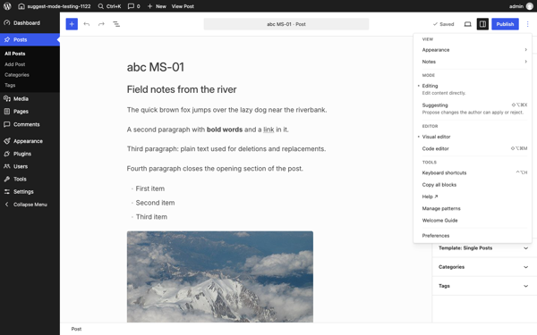</a> | 🟢 | ➖ |
| MS-03 | Switch to Suggesting via menu | Options > Mode > Suggesting. Snackbar announces "You're suggesting"; menu shows the active mode. | Unchanged from August. Options > Suggesting created one snackbar notice `editor-intent-mode` reading "You're suggesting"; reopening the menu shows `aria-checked="true"` on Suggesting and `"false"` on Editing. Typing " SUGG" afterwards produced marker `wp-suggestion-add` #23 and one note, so the mode is really active.  <a href="screenshots/MS-03-suggesting-active-in-menu.png">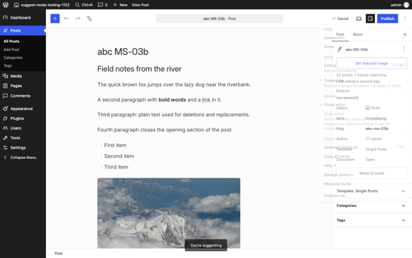</a> | 🟢 | 🟢 |
| MS-04 | Switch to Viewing via menu | Viewing is read-only: selection and scrolling work, typing, deleting, and block insertion are all inert. Toolbar/inserter reflect the read-only state. | Retired: Viewing mode was removed on 2026-10-27. Verified: the Options menu has no radio matching /View/ (count 0, only Editing and Suggesting), `getAllShortcutKeyCombinations( 'core/editor/intent-view' )` is `[]` with a `null` description, and pressing the old ⇧⌥⌘C created no notice and changed no block. F-01 and F-02 no longer apply.   | 🔴 | ➖ |
| MS-05 | Switch back to Editing | Returning to Editing restores full editing; a snackbar announces the change. | Unchanged from August. Options > Editing replaced the snackbar with "You're editing" (same notice id, no pile-up), the menu shows Editing `aria-checked="true"`, and typing " DIRECT" into the third paragraph landed in the block attribute directly (`...replacements. DIRECT`) with no new marker and the note count still 1.   | 🟢 | 🟢 |
| MS-06 | Keyboard shortcut cycle | `⇧⌥⌘Z` / `⇧⌥⌘X` / `⇧⌥⌘C` (Mac) switch to Editing / Suggesting / Viewing respectively, with snackbar each time. | Description note: only two shortcuts exist now (Viewing removed). ⇧⌥⌘X gave "You're suggesting", ⇧⌥⌘Z gave "You're editing", pressing either again in the mode it selects gave no snackbar, and the old ⇧⌥⌘C did nothing. It also works with focus on the top bar rather than the canvas. No character leaked into the paragraph, no console errors. The Keyboard shortcuts modal lists "Switch to Editing. ⇧⌥⌘Z" and "Switch to Suggesting. ⇧⌥⌘X". Unchanged from August apart from the retired third shortcut.    <a href="screenshots/MS-06-shortcut-help-modal.png">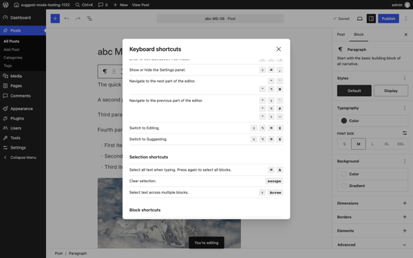</a> | 🟢 | 🟢 |
| MS-07 | Shortcuts gated by experiment | With the experiment off, the same shortcuts do nothing and do not swallow the keystroke from other handlers. | Retired: needs the experiment off, which this branch does not allow. | 🟢 | ➖ |
| MS-08 | Mode is session-scoped | Set Suggesting, reload the editor: mode returns to Editing. Check it is also not persisted per-user across posts. | Unchanged from August. Set Suggesting, reloaded: the menu shows Editing checked, typing " AFTERRELOAD" went straight into the block attribute with 0 markers and 0 notes. Set Suggesting again and opened a second post: Editing is checked there too. No `editorIntent` preference and no intent key in localStorage.   <a href="screenshots/MS-08-second-post-mode.png">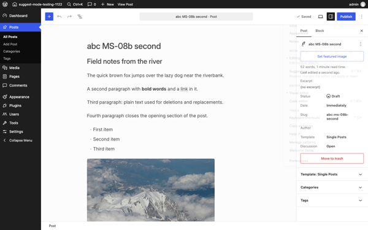</a> | 🟢 | 🟢 |
| MS-09 | Mode UI in Site Editor | Open the Site Editor: does the Mode menu appear there? Whatever the intended scope, behavior should be deliberate, not half-rendered. | Ran against the active theme (`ipsum`, a block theme), no theme switch. Fixed since August (F-03): editing the `ipsum//index` template, the Options menu offers only Visual editor / Code editor (no mode radios), all three `core/editor/intent-*` shortcut names have zero key combinations, ⇧⌥⌘X creates no notice, and the Keyboard shortcuts modal has no "Switch to ..." rows. Editing a page in the Site Editor is deliberately the opposite: both radios are present, ⇧⌥⌘X gives "You're suggesting", and typing " SITEEDIT" produced a `wp-suggestion-add` marker and note 72 on that page. The Site Editor header does have an Options (⋮) button now, unlike in August.  <a href="screenshots/MS-09-template-options-menu.png">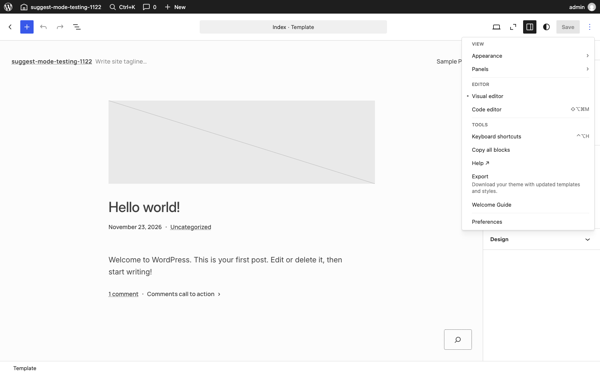</a> <a href="screenshots/MS-09-template-shortcuts-modal.png">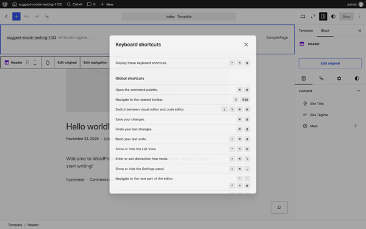</a> <a href="screenshots/MS-09-page-options-menu.png">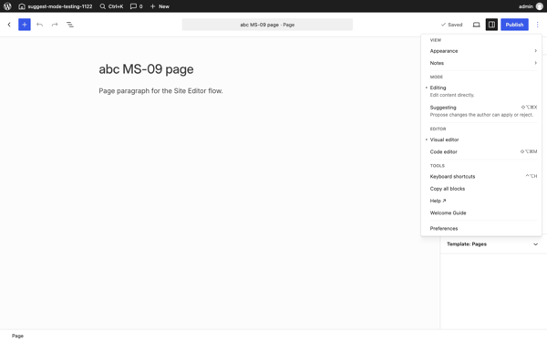</a> <a href="screenshots/MS-09-page-suggestion-in-site-editor.png">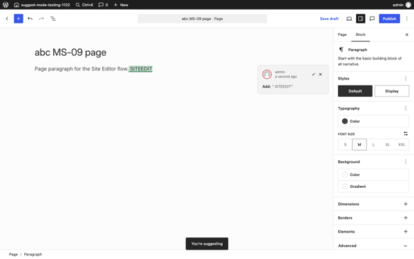</a> | 🟡 | 🟢 |
| MS-10 | Mode with code editor | Switch to the code editor while in Suggesting mode: what happens? Content should not be silently editable as raw HTML in a way that bypasses suggestions. | Fixed since August (F-04): the code editor is not reachable while Suggesting. With a pending addition (#42), the Code editor radio is `aria-disabled="true"` with the description "Raw HTML edits cannot be captured as suggestions. Switch to Editing to use the code editor."; a forced click, ⇧⌥⌘M and the command palette (no "code editor" result) all left `.editor-post-text-editor` hidden, and the shortcut raised a snackbar with the same sentence. Block count stayed 7, the marker and note survived, no console errors. Extra observation, not part of the flow: back in Editing with that suggestion still pending, the Code editor radio looks enabled, but clicking it or pressing ⇧⌥⌘M is refused with "The code editor is unavailable while this post has suggestions to resolve. Accept or reject them first." - correct outcome, but the menu item does not signal it up front the way it does while Suggesting.  <a href="screenshots/MS-10-code-editor-disabled-in-suggesting.png">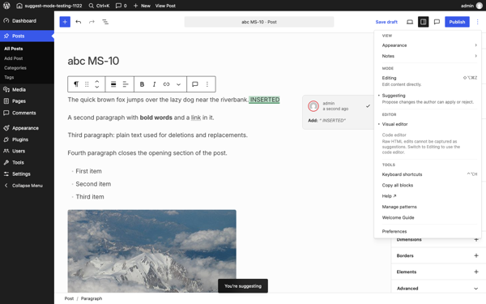</a> <a href="screenshots/MS-10-shortcut-refused.png">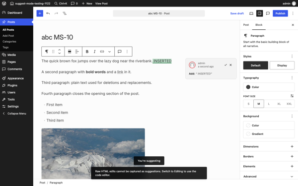</a> <a href="screenshots/MS-10-command-palette-suggesting.png">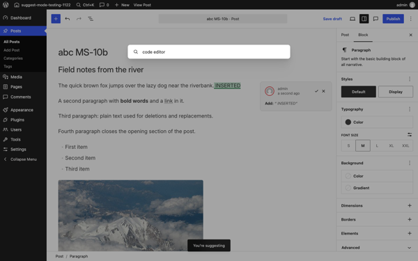</a> <a href="screenshots/MS-10-editing-with-pending-menu-click-refused.png">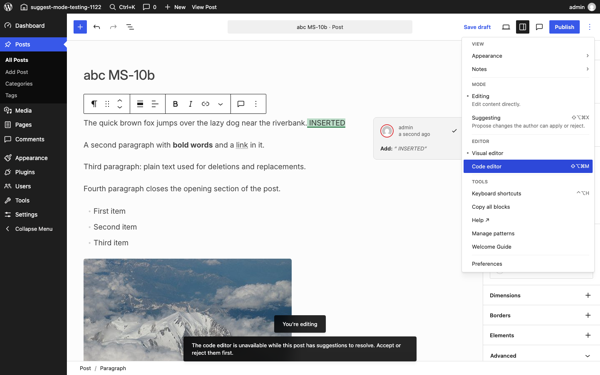</a> | 🔴 | 🟢 |
| MS-11 | Typing while Viewing announces nothing weird | In Viewing mode, mash keys: no characters land, no console errors, no snackbar spam. | Retired: Viewing mode was removed (see MS-04 for the evidence that there is no Viewing menu item or shortcut).   | 🔴 | ➖ |

### Section B - Inline text suggestions: additions

Show the 9 flows (IA-01 to IA-09) - 🟢 9

| ID | Test flow | Description | Result | Aug | Now |
|----|-----------|-------------|--------|-----|-----|
| IA-01 | Type mid-paragraph | Type a few words in the middle of a paragraph: underlined add marker, exactly one "Add: …" note (not "Format:"). | One marker `wp-suggestion-add` #162 = "MIDWORD " at offset 20, one note with a single `inline-suggestion` / `add` operation, sidebar reads `Add: “MIDWORD ”`, one POST. No "Format:" note, so the August watch item F-05 did not show up; none of the 30-odd other typed suggestions in this run produced one either.   | 🟡 | 🟢 |
| IA-02 | Type at paragraph start | Same, with the caret at position 0 of the block. Marker must not swallow the existing first character. | Unchanged from August. Content is `<mark ... #169>START </mark>The quick brown fox...`: the marker holds only "START " and the original "T" is outside it. One marker, one note `Add: “START ”`.  <a href="screenshots/IA-02-type-at-start.png">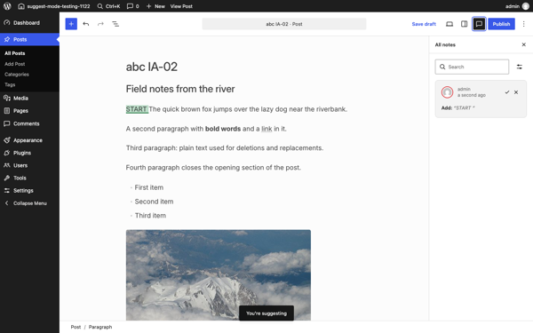</a> | 🟢 | 🟢 |
| IA-03 | Type at paragraph end | Same at the very end of the block, including trailing space handling. | Unchanged from August. Content ends `...riverbank.<mark ... #177> TRAILING </mark>` with both the leading and the trailing typed space inside the marker. One marker, one note `Add: “ TRAILING ”`.  <a href="screenshots/IA-03-type-at-end.png">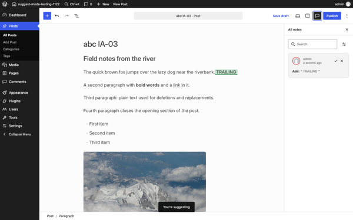</a> | 🟢 | 🟢 |
| IA-04 | Continuous typing grows one marker | Type a full sentence without pausing: one marker and one note, not one per keystroke or word. | Unchanged from August. A 47-character sentence typed at 25ms/key produced one marker (#182, the whole sentence), one note and exactly one POST to the notes endpoint.  <a href="screenshots/IA-04-continuous-typing-one-marker.png">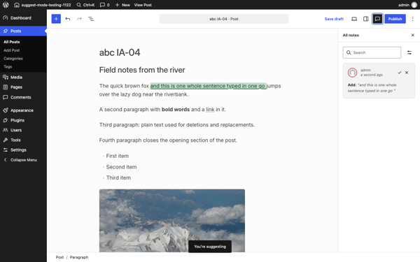</a> | 🟢 | 🟢 |
| IA-05 | Two separate additions, two notes | Add text in paragraph 1, then in paragraph 3: two distinct markers, two notes, each anchored to the right block. | Unchanged from August. Two markers (#187 "FIRSTADD " in paragraph 1, #188 "THIRDADD " in paragraph 3), two notes, `metadata.noteId` is `[187]` and `[188]` on those two blocks and absent on the heading and the other paragraphs.  <a href="screenshots/IA-05-two-additions-two-notes.png">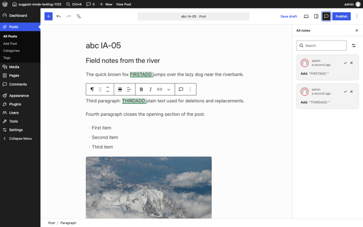</a> | 🟢 | 🟢 |
| IA-06 | Resume typing inside own add marker | Click back into the middle of your own pending addition and type more: extends the same marker/note rather than nesting a new one. | Fixed since August (F-06). Typed "ADDED" (#191), moved the caret back inside it with the arrow keys and typed "XX": still one marker #191 = "ADDEXXD", one note `Add: “ADDEXXD”`, `noteId: [191]`, no second POST. Same with a mouse click into the middle of a 13-character addition after leaving the block: one marker #192 = "ADDEDWXXORDHERE", one note. Small observation: two ArrowLeft presses from the end of the marker moved the caret one character, not two (the first press is spent on the marker edge).   <a href="screenshots/IA-06-resume-inside-own-marker-click.png">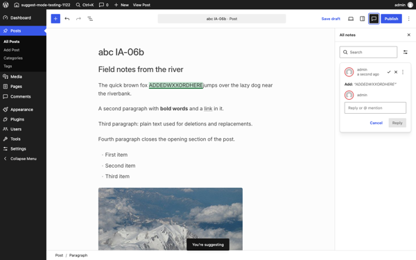</a> | 🔴 | 🟢 |
| IA-07 | Add adjacent to existing marker | Type immediately before/after an existing add marker: markers stay distinct or merge cleanly - no corrupted or nested markers. | Improved since August (three notes then, two now). With "MID" pending (#194), typing "PRE" with the caret immediately before it made a separate sibling marker #195; typing "POST" immediately after it extended #194 to "MIDPOST". Serialized content is two adjacent `<mark>` elements, not nested, `noteId: [194,195]`, two notes `Add: “PRE”` and `Add: “MIDPOST”`.  <a href="screenshots/IA-07-after-typing-before-marker.png">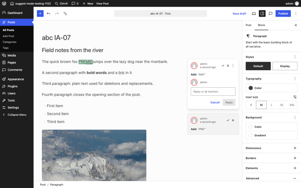</a> <a href="screenshots/IA-07-adjacent-markers.png">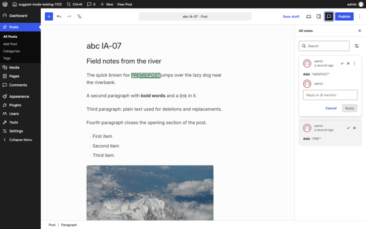</a> | 🟡 | 🟢 |
| IA-08 | Enter key inside a paragraph | Press Enter mid-paragraph in Suggesting mode: whatever the design (block split as structural suggestion, or blocked), it must be captured as a suggestion, not a direct edit. | Fixed since August (F-07). Enter at offset 20 is captured, not committed, and now reads as a diff: paragraph 1 keeps its full text with a rendered `wp-suggestion-del` marker #196 over "jumps over the lazy dog near the riverbank." (struck through), and a new paragraph with `metadata.suggestion.type: "pending-insert"` carries the tail in a dashed green outline. Two notes: `Delete: “jumps over ...”` and `Insert block: paragraph “jumps over ...”`. Still two independently decidable notes for one gesture, which is the known remaining gap of F-07.  <a href="screenshots/IA-08-enter-mid-paragraph.png">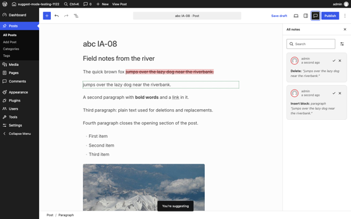</a> | 🟡 | 🟢 |
| IA-09 | Whitespace-only addition | Add just spaces/newline: is a sensible note created ("Add: ␣"?) and is the marker visible enough to review? | Fixed since August (the whitespace half of F-10). Three spaces typed mid-word give one marker #202 whose text is three U+0020, and the note now reads `Add: 3 spaces` rather than a collapsed `Add: " "`. The marker is 14.8px x 21px with a green tint and underline (`white-space: pre-wrap`), so it is small but visible.   | 🟡 | 🟢 |

### Section C - Inline text suggestions: deletions

Show the 12 flows (ID-01 to ID-12) - 🟢 10 · 🟡 2

| ID | Test flow | Description | Result | Aug | Now |
|----|-----------|-------------|--------|-----|-----|
| ID-01 | Delete selection | Select a phrase, press Delete: struck-through del marker, text remains until accepted, one "Delete: …" note. | Unchanged from August. One `wp-suggestion-del` marker #248 over "jumps", one note `Delete: “jumps”`, the rendered paragraph still reads the full sentence, computed `text-decoration-line: line-through` in dark red on a red tint. Backspace on the same selection gives the same result (#252).    | 🟢 | 🟢 |
| ID-02 | Backspace repeat merges | Backspace one character at a time repeatedly at a caret: one growing del marker and one note, not one per keystroke. | Unchanged from August. Five Backspace presses grew one marker #255 press by press ("s", "ps", "mps", "umps", "jumps"); one note `Delete: “jumps”`.   | 🟢 | 🟢 |
| ID-03 | Forward-delete | Press forward Delete (fn+Delete on Mac) at a caret and repeatedly: same merging behavior in the forward direction. | Fixed since August (F-08). Five forward Delete presses grew one marker #256 press by press ("j", "ju", "jum", "jump", "jumps"), the rendered text stayed the full sentence after every press, the caret stayed at offset 20, and there is one note `Delete: “jumps”` with no stale second note.    | 🔴 | 🟢 |
| ID-04 | Word-delete | Option/Ctrl+Backspace: whole word becomes one del marker. | Unchanged from August. Alt+Backspace after "jumps" gave one `del` marker #257 over "jumps" and one note.   | 🟢 | 🟢 |
| ID-05 | Line-delete | Cmd+Backspace (Mac, delete to line start): whole run marked deleted. | Unchanged from August. Cmd+Backspace at offset 25 gave one `del` marker #259 over "The quick brown fox jumps" and one note.   | 🟢 | 🟢 |
| ID-06 | Cut keeps the clipboard | Cmd/Ctrl+X a selection: del marker appears AND the clipboard actually contains the cut text (paste it into the browser URL bar or a plain field to prove it). | Unchanged from August. The clipboard was seeded with a sentinel, then Cmd+X on "jumps": `navigator.clipboard.readText()` returns `jumps`, a `del` marker #263 covers "jumps", one note `Delete: “jumps”`, text still in the block.   | 🟢 | 🟢 |
| ID-07 | Grapheme safety: emoji | Backspace over 👨‍👩‍👧 and a flag emoji: whole grapheme marked, no split surrogate pairs, no mojibake. | Unchanged from August. One Backspace after the flag marks code points `[1f1ef, 1f1f5]` (#265); one Backspace after the family emoji marks `[1f468, 200d, 1f469, 200d, 1f467]` (#266). One marker and one note each, no lone surrogates in either block's content.  <a href="screenshots/ID-07-emoji-grapheme.png">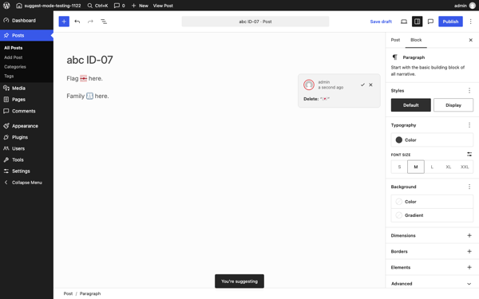</a> <a href="screenshots/ID-07b-zwj-family-emoji.png">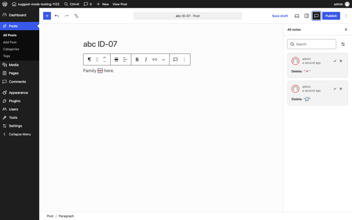</a> | 🟢 | 🟢 |
| ID-08 | Delete spanning two blocks | Select from mid-paragraph-1 to mid-paragraph-2 and delete: captured as suggestions (per-block del markers or structural), never a direct merge of blocks. | Captured, never a direct merge: block count stays 7 and both blocks keep their attributes. F-10 is fixed here - the summaries are readable, with spaces and no raw tags. Still no inline markers: it is two structural notes, one block struck through whole and the other outlined showing the merged result. Rough edge: the two keys describe the same edit in opposite directions. Backspace gives `Replace: “deletions and replacements.” → “del closes the opening section of the post.”` on paragraph 3 plus `Remove block` on paragraph 4. Delete gives `Remove block: paragraph “Third paragraph: ...”` plus `Replace: “Fourth paragraph” → “Third paragraph: plain text used for del”` on paragraph 4, so the paragraph whose first half survives is shown as removed. (A zero-delay scripted run also produced a wrong merge, but Editing mode does the same at that speed, so that was the script, not the feature.)  <a href="screenshots/ID-08-selection-before-delete.png">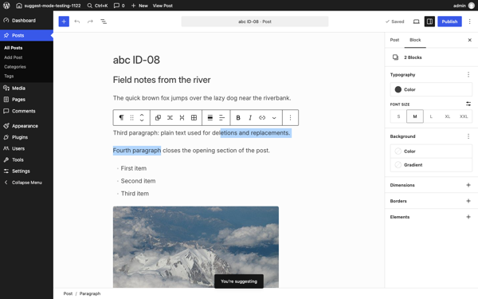</a> <a href="screenshots/ID-08-delete-spanning-two-blocks.png">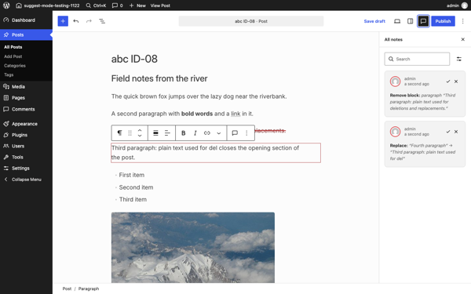</a> <a href="screenshots/ID-08-backspace-spanning-two-blocks.png">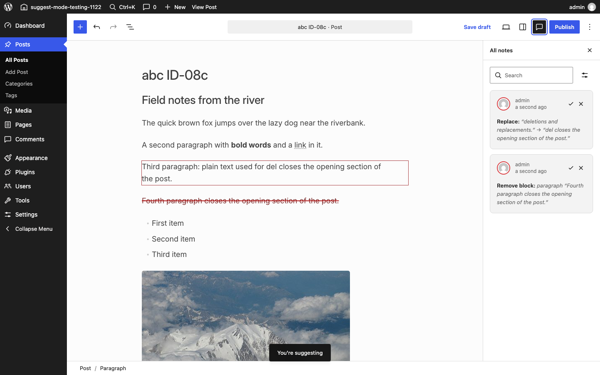</a> | 🟡 | 🟡 |
| ID-09 | Select-all delete within block | Cmd/Ctrl+A within a block then Delete: block's whole text struck through; block itself remains. | Unchanged from August. Cmd+A then Delete: one `del` marker #283 over the entire paragraph text, one note, block count 7, block still present.   | 🟢 | 🟢 |
| ID-10 | Backspace at block start | Caret at position 0, press Backspace (would normally merge with previous block): captured or safely blocked, never a silent direct merge. | Unchanged in substance from August. Never a silent merge (7 blocks, attributes untouched): the heading gets a `pending-attributes` overlay and the paragraph `pending-remove`, rendered as an outlined heading reading "Field notes from the riverThe quick brown fox..." above the struck-through paragraph. No inline marker, and the note still describes an append as a replacement of the last word: `Replace: “river” → “riverThe quick brown fox jumps over the lazy dog near the r…”`. Same shape paragraph-after-paragraph: `Replace: “it.” → “it.Third paragraph: ...”`.  <a href="screenshots/ID-10-backspace-at-block-start.png">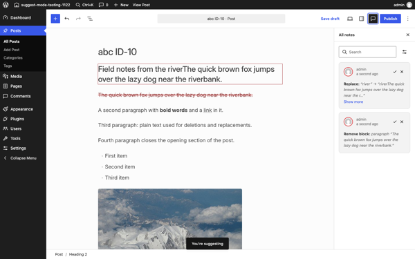</a> <a href="screenshots/ID-10-backspace-at-paragraph-start-after-paragraph.png">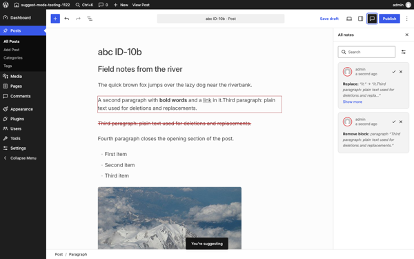</a> | 🟡 | 🟡 |
| ID-11 | Delete straddling an existing marker | Make an add suggestion, then select a range that half-overlaps it and delete: the existing suggestion must not be corrupted (issue says straddling edits are left alone). | Fixed since August (F-09). With `add` "PENDING" pending, deleting the selection "INGjumps" trimmed the addition to "PEND" (#295) and put a `del` marker #296 on "jumps". Both markers render, content is two sibling `<mark>` elements, `noteId: [295,296]`, notes `Add: “PEND”` and `Delete: “jumps”`. No overlay, no whole-content note.  <a href="screenshots/ID-11-selection-before-delete.png">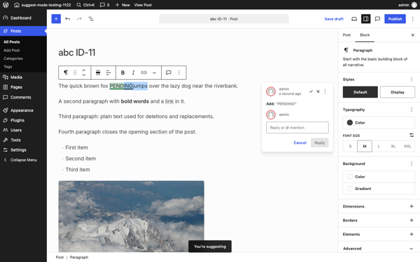</a> <a href="screenshots/ID-11-delete-straddling-marker.png">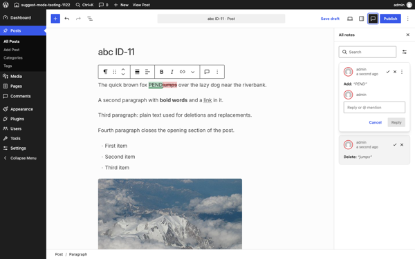</a> | 🔴 | 🟢 |
| ID-12 | Delete your own pending addition | Select text that is entirely inside your own add marker and delete it: ideally the addition simply shrinks/withdraws rather than stacking del-over-add. | Fixed since August (F-09). Deleting "NDI" inside a pending "PENDING" shrank the same marker to "PENG" (#302), still one note `Add: “PENG”`, no del-over-add. Deleting the rest withdraws it: 0 markers, clean content, and the note is trashed about half a second later (PUT, status `trash`) in all six variants tried (selection + Backspace, selection + Delete, character by character, shrink first, shrink first with the sidebar open, leave the block and come back). Leftover: the block keeps `metadata.noteId: [<trashed id>]` in the editor after the withdrawal.   <a href="screenshots/ID-12-shrink-then-rest.png">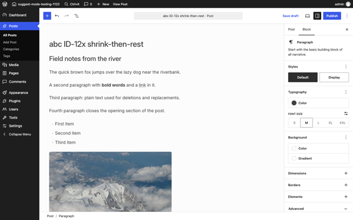</a> <a href="screenshots/ID-12-shrink-then-rest-sidebar-open.png">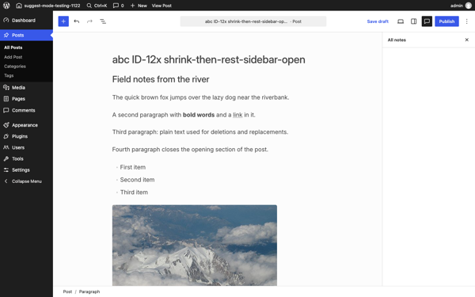</a> | 🔴 | 🟢 |

### Section D - Inline text suggestions: replace, paste, and input seams

Show the 10 flows (IR-01 to IR-10) - 🟢 2 · 🟡 6 · 🔴 2

| ID | Test flow | Description | Result | Aug | Now |
|----|-----------|-------------|--------|-----|-----|
| IR-01 | Type over selection | Select a phrase and type: del + add marker pair, two notes. | Selecting "jumps" and typing "leaps" gives an `add:"leaps"` and a `del:"jumps"` marker sharing one id, and **one** note summarised `Replace: “jumps” → “leaps”` (new behaviour: August had two notes). Rough edge: the new text is stored and rendered *before* the struck text ("fox leapsjumps over"), the reverse of August ("jumpsleaps") and of the reconciler seams in IR-06/07/08, which put the deletion first.  <a href="screenshots/IR-01-type-over-selection.png">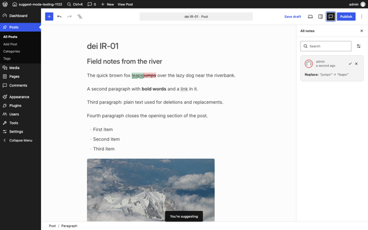</a> | 🟢 | 🟡 |
| IR-02 | Paste single line | Paste one line of plain text at a caret: one add marker, one note. | Unchanged. Pasting "PASTEDLINE " before "jumps" gives one `add:"PASTEDLINE"` marker and one note `Add: “PASTEDLINE”`; block count 7, no raw commit. (The trailing space of the clipboard text is not in the marker.)  <a href="screenshots/IR-02-paste-single-line.png">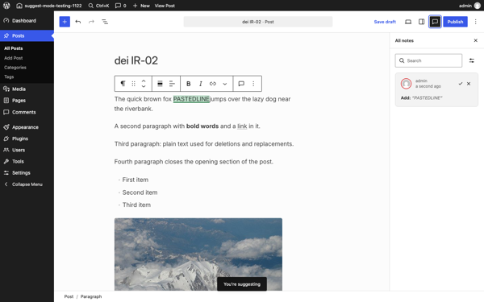</a> | 🟢 | 🟢 |
| IR-03 | Paste over selection | Paste a single line over a selection: del + add pair. | `add:"REPLACED"` + `del:"jumps"` sharing one id, one note `Replace: “jumps” → “REPLACED”` (new: one note, not two). Same ordering rough edge as IR-01: renders "fox REPLACEDjumps over", new text ahead of the struck text.   | 🟢 | 🟡 |
| IR-04 | Paste multiple lines | Paste multi-line text: captured as a whole-attribute suggestion (never a raw commit). Verify the note describes it usefully. | Never a raw commit: block 1 content is byte-identical and carries `pending-attributes` with `after: "The quick brown fox LINE ONE LINE TWO LINE THREE"`; the tail becomes a new `pending-insert` paragraph (blocks 7 → 8), which matches what the same paste does in Editing mode (control run). Summaries now keep their spaces (F-10 fixed since August): `Replace: “jumps over the lazy dog near the riverbank.” → “LINE ONE LINE TWO LINE THREE”` and `Insert block: paragraph “jumps over the lazy dog near the riverbank.”`. Still rough: no inline marker on block 1, the tail reads as both "replaced" and "inserted", and the two notes are unlinked (accept one and reject the other and the tail is duplicated or lost).  <a href="screenshots/IR-04-paste-multiple-lines.png">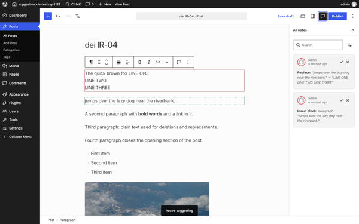</a> | 🟡 | 🟡 |
| IR-05 | Paste rich text | Paste bolded/linked HTML from another page: captured as suggestion; formatting either preserved in the suggestion or cleanly normalized - no raw commit. | Fixed since August (F-29). One `add` marker, one note `Add: “rich bold and a link”`, and the formatting is preserved inside the marker: `<mark ...add>rich <strong>bold</strong> and a <a href="https://example.com">link</a></mark>`. No raw commit.   | 🟡 | 🟢 |
| IR-06 | Autocorrect seam | Trigger an autocorrect-style replacement (scripted: simulate the browser replacing "teh " with "the " via input events without beforeinput keydowns): reconciled into add/del markers. | Reconciled into `del:"teh"` + `add:"the"` (whole words, deletion first), two notes `Delete: “teh”` and `Add: “the”`, base text intact. Two notes here versus one "Replace" note for a typed replacement (IR-01) is a small inconsistency. **Approximation:** synthetic `insertReplacementText` beforeinput/input with a scripted DOM mutation, not a real OS autocorrect; needs manual verification.  <a href="screenshots/IR-06-autocorrect-seam.png">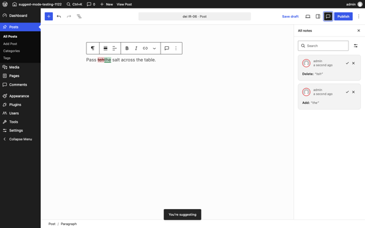</a> | 🟡 | 🟡 |
| IR-07 | IME composition commit | Approximate an IME commit (compositionstart/update/end sequence via CDP, e.g. Japanese text): committed text reconciled into an add marker; no duplicate text. | Composing over a selected "brown" gives `del:"brown"` + `add:"こんにちは"`, two notes, rendered "brownこんにちは" with no duplicated text; composing at a collapsed caret gives a single `add:"ねこ"` and one note. Unchanged from August. **Approximation:** CDP `Input.imeSetComposition` + `Input.insertText`, not a real IME; needs manual verification.   <a href="screenshots/IR-07-ime-composition-caret.png">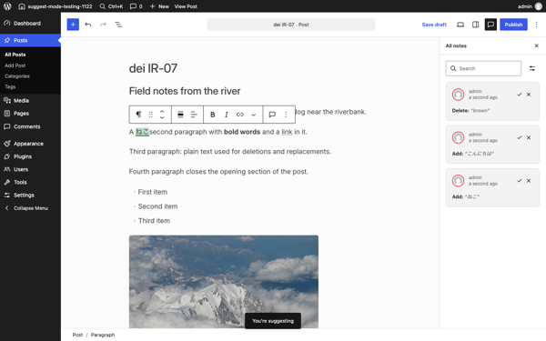</a> | 🟡 | 🟡 |
| IR-08 | Spellcheck replace | Right-click a misspelled word and accept the browser suggestion (or simulate the same DOM mutation): reconciled into del+add markers. | Improved since August: correcting "teh" to "the" now yields whole-word `del:"teh"` + `add:"the"` (August: `del:"eh"` + `add:"he"`), summaries `Delete: “teh”` / `Add: “the”`. **Approximation:** synthetic `insertReplacementText`, not a real context-menu correction; needs manual verification.   | 🟡 | 🟡 |
| IR-09 | Drag-drop text within a block | Select text and drag it elsewhere in the same paragraph: reconciled into del (origin) + add (destination) markers. | Now driven with a real mouse drag (mousedown on the selection, 600ms hold, move, release; `dragstart` and `drop` both fired) and it is **half captured**. Dragging "brown " to before "lazy" leaves a `del:"brown "` marker and a `Delete: “brown ”` note at the origin, nothing at the destination, and a snackbar "The edit could not be captured as a suggestion." The same drag in Editing mode moves the text ("The quick fox jumps over the brown lazy dog"). So the move is refused but a stray deletion suggestion is left behind. August could not automate this flow.  <a href="screenshots/IR-09-drag-in-flight.png">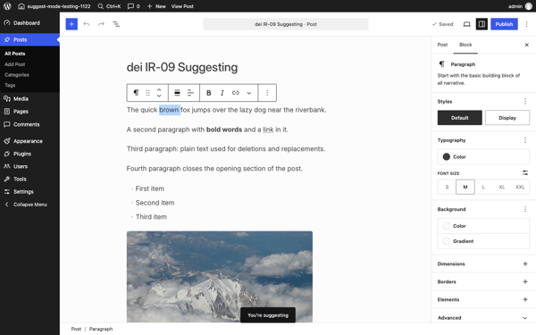</a> <a href="screenshots/IR-09-drag-drop-text.png">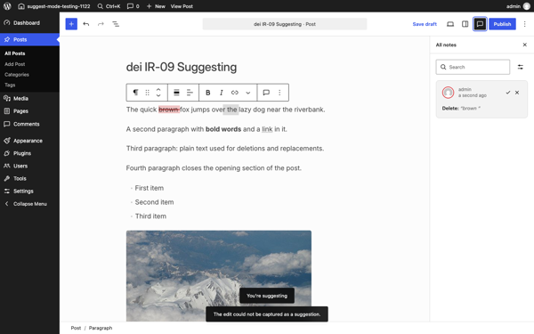</a> <a href="screenshots/IR-09-control-editing-mode.png">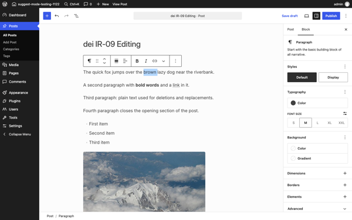</a> | 🟡 | 🔴 |
| IR-10 | Marker/overlay invariant | After running IR-01..IR-09 on one post, assert no block carries both an inline marker and an overlay diff (the stack's stated invariant; check block attributes in the console). | August's trigger is fixed: deleting "eap" inside my own pending `add:"leaps"` now just shrinks the marker to `add:"ls"` with no second note (F-09 gesture resolved), and no `ins`/`del` overlay element renders anywhere (0 in the DOM, 9 markers rendered). But the invariant still breaks at the data level through a different door: a multi-line paste into a block that already has a pending inline add leaves that block with `metadata.noteId: [151, 171]`, an inline `<mark>` for 151 in its content AND `metadata.suggestion.type: "pending-attributes"` for 171 whose `after` snapshot embeds the mark. Consequence (follow-up run): reject the inline add (content loses the mark, note shows "Rejected") while the canvas still shows the "PASTEDLINE" marker from the overlay; then accept the overlay (confirm dialog "This block has changed since the suggestion was made... Apply anyway") and the rejected mark is written back into the block content and its note summary returns to `Add: “PASTEDLINE”`.  <a href="screenshots/IR-10-marker-overlay-invariant.png">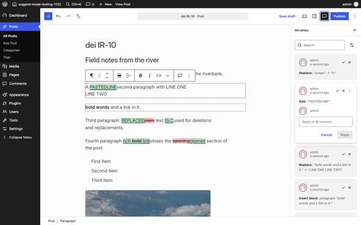</a> <a href="screenshots/IR-10-marker-plus-overlay-one-block.png">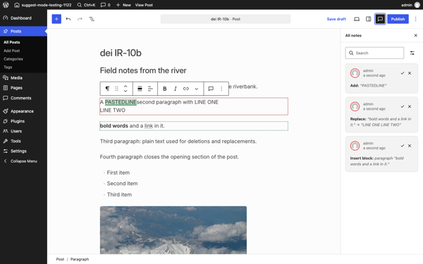</a> <a href="screenshots/IR-10-accept-overlay-confirm.png">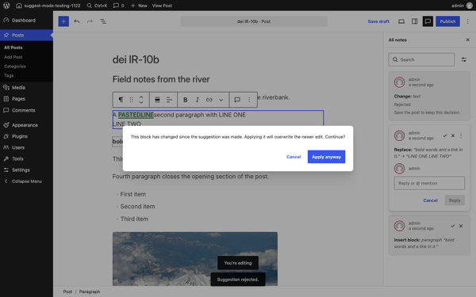</a> <a href="screenshots/IR-10-reject-inline-accept-overlay.png">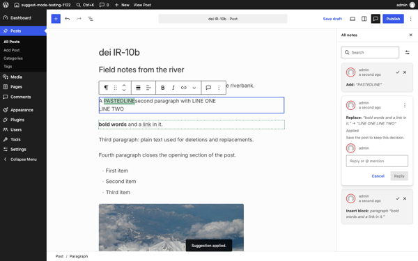</a> | 🔴 | 🔴 |

### Section E - Formatting-only suggestions

Show the 8 flows (FS-01 to FS-08) - 🟢 8

| ID | Test flow | Description | Result | Aug | Now |
|----|-----------|-------------|--------|-----|-----|
| FS-01 | Bold a run | Select clean text, toggle bold: one format marker (dotted underline), text not duplicated, one "Format:" note. | One `format` marker over "jumps", one note, text not duplicated. Serializes as `<mark ...format><strong>jumps</strong></mark>` (the marker now wraps the format; August had it the other way round). Computed style on the marker: `text-decoration: underline dotted`. Label is now `Add formatting: bold`.   | 🟢 | 🟢 |
| FS-02 | Italic a run | Same for italic. | Same shape with `<em>`: one `format` marker, one note `Add formatting: italic`, dotted underline, text intact.   | 🟢 | 🟢 |
| FS-03 | Add a link | Select text, add a link with a URL: format marker; note records enough to review; the link is not live-navigable in a way that loses work. | Fixed since August: ⌘K, type URL, Enter gives `<mark ...format><a href="https://example.com/target">jumps</a></mark>`, one note, and the note now shows the target: `Add formatting: link` / `Link: https://example.com/target`. Clicking the pending link in the canvas does not navigate (URL unchanged, no new tab).  <a href="screenshots/FS-03-link-popover.png">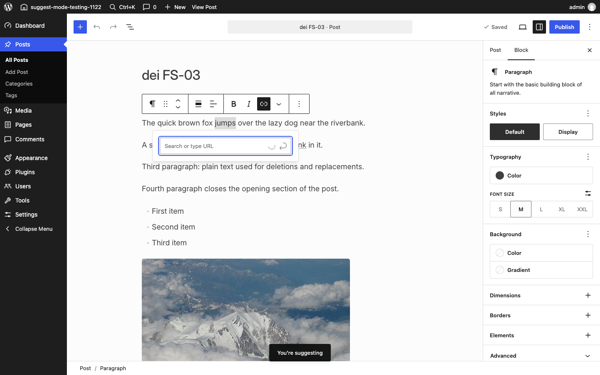</a>  | 🟡 | 🟢 |
| FS-04 | Remove existing formatting | Select already-bold text and toggle bold OFF: captured as a format suggestion whose Reject restores the original bold. | Fixed since August (F-11): the note now reads `Remove formatting: bold`, distinct from adding. Proposed content is `<mark ...format>bold words</mark>` with the `<strong>` dropped; Reject ("Suggestion rejected." snackbar) restores `<strong>bold words</strong>` exactly.   <a href="screenshots/FS-04-reject-restores-bold.png">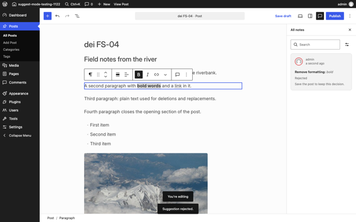</a> | 🟡 | 🟢 |
| FS-05 | Stacked toggles on one run | Bold then italicize the same selection: one marker with both changes, or two clean markers - not duplicated text or nested markers. | Fixed since August (F-12): the second toggle extends the same marker. Content becomes `<mark data-suggestion-id="446" ...format><strong><em>jumps</em></strong></mark>`, still one note, summary grows to `Add formatting: bold, italic`. No duplicated text, no nested suggestion markers. (First attempt showed the italic "lost"; that was the script pressing ⌘I with focus in the notes sidebar, not the product.)  <a href="screenshots/FS-05-stacked-toggles.png">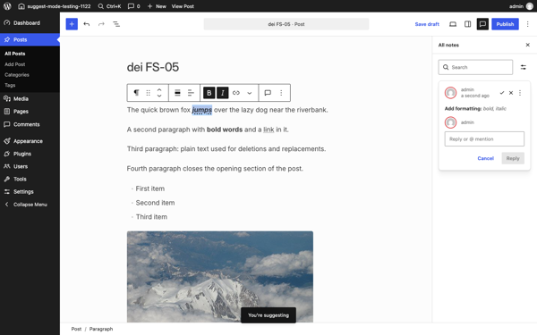</a> | 🔴 | 🟢 |
| FS-06 | Format overlapping an add marker | Bold a range that includes your own pending added text: no marker corruption; sensible combined result. | Fixed since August (F-12): bolding "fox NEW jumps" across my pending `add:"NEW "` gives format markers on "fox " and "jumps" (one id, one note `Add formatting: bold`) and the add marker keeps its own id with the bold inside it (`<mark ...add><strong>NEW </strong></mark>`). Two notes, three rendered markers, text reads "fox NEW jumps" once.   | 🔴 | 🟢 |
| FS-07 | Format across two blocks | Select across a block boundary and bold: per-block format suggestions or a clean refusal, never a direct commit. | Fixed since August (F-30): the refusal is now explained. With a multi-block selection ⌘B changes nothing (all block content byte-identical, 0 notes, 0 markers) and a snackbar says "Formatting suggestions apply to a selection within a single block."  <a href="screenshots/FS-07-format-across-blocks.png">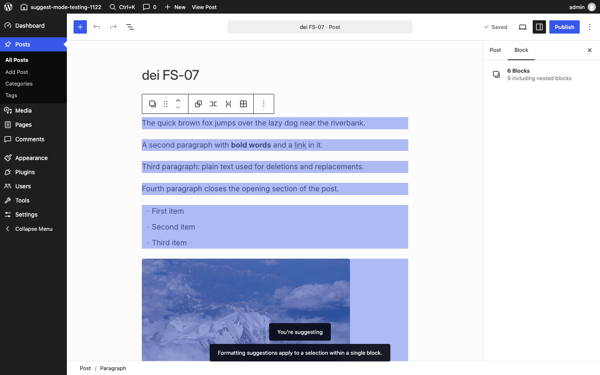</a> | 🟡 | 🟢 |
| FS-08 | Unsupported format buttons | Try other RichText formats (inline code, strikethrough, highlight, superscript) in Suggesting mode: each either becomes a proper suggestion or is visibly disabled - no silent direct edits. | Now automated (the items are `menuitemcheckbox`, which is why August's `menuitem` lookup failed). All four become proper suggestions: `<mark ...format><code>quick</code></mark>`, `<s>second</s>`, `plain` and `<mark style="background-color:#fcfcfc" class="has-inline-color">closes</mark>`, each inside its own format marker with notes `Add formatting: code` / `strikethrough` / `superscript` / `highlight`. Editing-mode control applies the same formats directly with no markers. Not exercised: Text color, Keyboard input, Subscript, Language, Inline image, Math, Footnote.  <a href="screenshots/FS-08-more-formats-menu.png">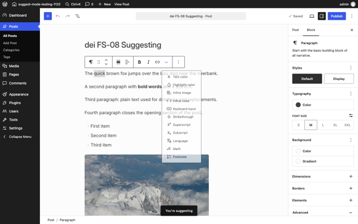</a> <a href="screenshots/FS-08-other-formats.png">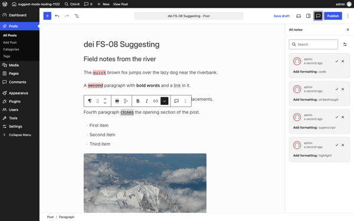</a> <a href="screenshots/FS-08-control-editing-mode.png">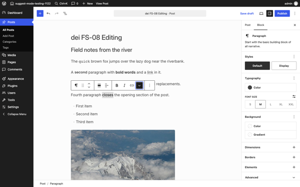</a> | 🟡 | 🟢 |

### Section F - Structural suggestions: insert, remove, move

Show the 17 flows (ST-01 to ST-17) - 🟢 15 · 🟡 2

| ID | Test flow | Description | Result | Aug | Now |
|----|-----------|-------------|--------|-----|-----|
| ST-01 | Insert block and type | Insert a paragraph, type into it: exactly ONE "Insert block" note (no extra "Add" note); pending-insert visual treatment on the block. | Unchanged from August. Enter after the first paragraph creates an empty paragraph with no note and no metadata; typing "New inserted paragraph" then makes exactly one write (`POST /comments` 201, note 25, one `block-insert-after` operation). The block carries `metadata.suggestion.type: "pending-insert"`, `noteId: [25]` and the DOM class `is-suggestion-pending-insert`; zero inline markers, so no extra "Add" note. Sidebar summary: "Insert block: paragraph “New inserted paragraph”". No console errors.   | 🟢 | 🟢 |
| ST-02 | Empty inserted block suggests nothing | Insert a paragraph and leave it empty: no suggestion/note until it has content. Then click away/reload: the empty block should not linger oddly. | First half unchanged: the empty inserted paragraph gets no note, no metadata and no suggestion class, even after clicking away (0 notes, no "All notes" toggle in the top bar). New observation on the second half: the empty block does linger. The post goes dirty, and "Save draft" pressed while still Suggesting writes the empty paragraph into the stored post content (`POST /posts/281` 200, stored content has 5 paragraph blocks and one `

`); after a reload it is still there as a plain block with no suggestion attached. August only reloaded without saving, so this was not seen then.     | 🟢 | 🟡 |
| ST-03 | Insert non-text block | Insert an Image block and select an image: captured as insert suggestion; media upload works; front end hides it until accepted. | Now covered end to end, including the upload path August skipped. Inserting an Image block from the inserter creates the note at once, while the block is still a placeholder (note 193, "Insert block: image", `pending-insert`). A real file upload through the block's file input then succeeds (`POST /media` 201, `POST /media/172/finalize` 200) and fills `id: 172` and `url` on the same pending block without a second note. After Save on the published post the stored content holds the image block with its `pending-insert` metadata, and the signed-out front end shows only the original seed image, not the uploaded one. No console errors.     | 🟡 | 🟢 |
| ST-04 | Insert via slash command | `/heading` in an empty paragraph: block conversion + insert captured coherently as suggestion(s). | Unchanged from August. `/heading` opens the autocomplete (Heading, Heading 1-6, Table of Contents), Enter converts the pending empty paragraph, and typing "Slash title" leaves one `core/heading` with `pending-insert` and one note (32) with a single `block-insert-after` operation for `core/heading`. Summary: "Insert block: heading “Slash title”". No remove and insert pair.    | 🟢 | 🟢 |
| ST-05 | Remove a block | Delete a paragraph via block toolbar options: block stays visible with struck-through pending-remove treatment, one "Remove block:" note. | Unchanged from August. Options > Delete on the third paragraph keeps all blocks in place; the paragraph carries `pending-remove`, class `is-suggestion-pending-remove` and a computed `text-decoration-line: line-through`. One note (39): "Remove block: paragraph “Third paragraph: plain text used for deletions and replacements.”".   | 🟢 | 🟢 |
| ST-06 | Remove via select + Delete key | Select a block (Escape to block selection) and press Delete/Backspace: same pending-remove capture. | Now verified with two real block-selection gestures, so better than August's "no verdict". Clicking the Image block (the figure takes focus, selection has no offset) and pressing Backspace gives `pending-remove` on the image and one note "Remove block: image"; selecting a paragraph row in List View and pressing Backspace gives `pending-remove` on that paragraph and one note "Remove block: paragraph …". The Editing-mode controls remove the blocks outright, so the capture is specific to Suggesting. The literal Escape route still cannot be driven by the script: after Escape the caret offset stays put and Backspace does nothing in Editing and Suggesting alike, so that one path needs a manual check.      | 🟡 | 🟢 |
| ST-07 | Remove multi-block selection | Shift-click to select 3 blocks and delete: all three get pending-remove; note(s) sensible (one grouped or three individual - document which). | With three whole blocks selected (List View click then Shift-click: heading, paragraph, paragraph) Backspace gives `pending-remove` on all three, all stay visible, and there are three individual notes ("Remove block: heading …", "Remove block: paragraph …" twice), same as August. A Shift-click in the canvas is different, because Gutenberg makes that a partial text selection from caret to click point: Backspace then produces "Replace: “lazy dog near the riverbank.” → “laletions and replacements.”" as a whole-content overlay on the first paragraph (`pending-attributes`, no inline markers) plus two "Remove block" notes. That matches what Editing mode would do, but the three notes carry no `groupId`, so the third paragraph shows fully struck through although its tail is proposed to survive in the first one.     | 🟢 | 🟡 |
| ST-08 | Move block down | Move a paragraph down via toolbar arrows: block lands at proposed position with pending-move treatment; non-interactive ghost marks its origin. | Unchanged from August. Move down on the first paragraph lands it one position lower with `pending-move` (`fromIndex: 1`) and one note (56) "Move block: paragraph “The quick brown fox …”". The origin shows a ghost reading "Moved from here: Paragraph" with the text struck through, and a "Suggested move destination." marker sits before the moved block.   | 🟢 | 🟢 |
| ST-09 | Move same block twice | Move it again: still a single note; ghost tracks the ORIGINAL origin. | Unchanged from August. The second Move down updates the same note (`POST /comments/56` 200; note ids before and after are both [56]) and the ghost stays at the original position (directly after the heading) while the block moves to index 3. The "Suggested move" badge is still partly covered by the block toolbar while the block is selected.   | 🟢 | 🟢 |
| ST-10 | Move via drag handle | Drag a block by its handle to a new position: same pending-move capture as arrows. | Now automated, so no longer "no verdict". Dragging the block by the toolbar Drag handle with real mouse events onto the lower half of the third paragraph shows the drop indicator and, on release, gives the same capture as the arrows: `pending-move` with `fromIndex: 1`, one note (239) "Move block: paragraph …", and a ghost at the origin.    | 🟡 | 🟢 |
| ST-11 | Ghost is non-interactive | Click, type at, and try to select the origin ghost: it must be inert and unselectable, and not confuse List View. | Still inert. The ghost has `pointer-events: none`, `user-select: none`, `contenteditable="false"`, no editable or tabbable descendants, and now `role="note"` with a visually hidden "Original position of moved Paragraph block." and an `aria-hidden` visible label. A real click on it falls through to the canvas: the caret lands at the end of the paragraph just below, and typing "GHOSTTYPE" becomes an ordinary "Add" suggestion there (August saw nothing happen). The ghost text is unchanged and a triple click selects nothing in it. List View shows 7 rows with no ghost row, and the moved row is described as "Suggested move destination.".   | 🟢 | 🟢 |
| ST-12 | Move then edit the moved block | Move a block, then type inside it at its new position: inline add suggestion coexists with pending-move treatment. | Unchanged from August. After the move, typing "EDITED " at the start of the moved paragraph adds an inline marker (`add`, id 66) while the block keeps `pending-move`; `noteId` is [65, 66] and the sidebar lists "Move block: paragraph …" and "Add: “EDITED ”". Small detail: the ghost at the origin and the Move summary both quote the text with the unaccepted "EDITED " in it.   | 🟢 | 🟢 |
| ST-13 | Insert then remove same block | Insert a block with content, then delete it while still pending: suggestion should cleanly withdraw (net no-op), not leave both an insert and a remove note. | Unchanged from August. Insert and type creates note 70 (`hold`); Options > Delete on the still-pending block sends one update to the same note, which ends in `trash`. No remove note is created, the sidebar has no cards, no block carries suggestion metadata and the block list is back to the seed.   | 🟢 | 🟢 |
| ST-14 | Nested structure: inside a Group | Inside a Group block, insert/remove/move a child paragraph: capture and treatments work at nesting depth; List View coherent. | Now fully covered, and improved since August. Inside a Group, an inserted paragraph gets `pending-insert`, a deleted sibling gets `pending-remove` and stays visible, and a sibling moved down gets `pending-move` (`fromParentClientId` is the Group) with its ghost inside the Group. Insert and remove summaries now name the nesting ("Insert block: paragraph in group …", "Remove block: paragraph in group …"); the move summary does not ("Move block: paragraph “Group child B.”"). List View is coherent: level 2 rows are described as "Suggested insertion.", "Suggested move destination." and "Suggested removal.". No console errors.    | 🟡 | 🟢 |
| ST-15 | List items | In a List block, add a list item, delete one, and reorder: captured as suggestions (document at which granularity - block vs inner text). | Now fully covered. Granularity is the inner `core/list-item` block, as in August. Enter and typing after "Third item" gives `pending-insert` ("Insert block: list-item in list “Fourth item”"); Options > Delete on "First item" gives `pending-remove` ("Remove block: list-item in list “First item”"). Reordering, not exercised in August, works with the toolbar: Move down on "First item" gives `pending-move`, a ghost "Moved from here: List Item" at the top of the list and one note "Move block: list-item “First item”".    | 🟡 | 🟢 |
| ST-16 | Duplicate a block | Use Duplicate from the block menu: captured as an insert suggestion of the copy. | Unchanged from August. Options > Duplicate adds the copy directly below with `pending-insert` and one note (75) "Insert block: paragraph “The quick brown fox …”"; the original is untouched.   | 🟢 | 🟢 |
| ST-17 | Transform block type | Transform a paragraph into a quote via the block switcher: captured as a suggestion (attribute or remove+insert - document which) and reviewable. | Still captured as remove plus insert (paragraph `pending-remove`, new `core/quote` `pending-insert`, two cards: "Remove block: paragraph …" and "Insert block: quote"), but the two halves are now linked: both notes share a `groupId` (`sg-…-1`). Rejecting the first card rejected both (`_wp_suggestion_status: rejected-unsaved` on notes 189 and 190), removed the quote and cleared the paragraph's treatment, so the hole or duplicate August warned about cannot be produced that way. Fixed since August. Accepting one half was not exercised.    | 🟡 | 🟢 |

### Section G - Attribute and metadata suggestions

Show the 11 flows (AT-01 to AT-11) - 🟢 9 · 🟡 1 · 🔴 1

| ID | Test flow | Description | Result | Aug | Now |
|----|-----------|-------------|--------|-----|-----|
| AT-01 | Heading level | Change H2 → H3 via the block switcher: attribute suggestion, level shown changes, note records it, Reject restores H2. | Unchanged in substance. The block attribute stays `level: 2` with `pending-attributes` `after: {level: 3}`, the canvas renders an `H3`, and there is one note (258). The summary is now "Change: heading level 2 → 3" (August: "Format: heading level"). Reject shows "Suggestion rejected.", the canvas is back to `H2` and the note is `rejected-unsaved`. No console errors.    | 🟢 | 🟢 |
| AT-02 | Text alignment | Change paragraph alignment: attribute suggestion. | Captured, not committed: `pending-attributes` with `after: {style: {typography: {textAlign: "center"}}}`, the stored attributes unchanged, and the canvas previews centred text. One note (264). The summary is only "Change: style", which no longer says that alignment is what changed (August: "Format: alignment, style"), so the label is less clear than before.   | 🟢 | 🟡 |
| AT-03 | Block alignment (wide/full) | Change an image's alignment to wide: attribute suggestion including layout reflow preview. | Unchanged in substance. Align block > Wide width gives `pending-attributes` `after: {align: "wide"}` with the stored attribute untouched; the canvas previews it (class `alignwide`, width 640px to 672px). One note (412): "Change: alignment default → wide". Reject returns the image to 640px.   | 🟢 | 🟢 |
| AT-04 | Color / typography sidebar controls | Change text color and font size from the block sidebar in Suggesting mode: captured as attribute suggestions or visibly disabled - no direct commits. | Regressed. Each control alone is captured and not committed (text colour: `after: {textColor: "accent-1", style.elements.link…}`, previewed in blue; font size: `after: {fontSize: "large"}`, "Change: font size default → large"). But making both changes on the same paragraph loses the first one: after colour then font size, note 447 holds only the `fontSize` operation, the preview is back to the default colour and the summary reads only "Change: font size default → large". In the other order the font size is dropped instead and the summary is "Change: style, text color default → accent-1". The same clicks in Editing mode keep both attributes. August recorded one note covering both.      | 🟢 | 🔴 |
| AT-05 | Additional CSS class | Set a custom class under Advanced: captured or blocked; document which. | Still captured, and the label is fixed. Typing a class under Advanced gives `pending-attributes` `after: {className: "fg-custom-class"}` and one note (294): "Change: additional CSS class default → fg-custom-class" (August: "Format: classname"). The field shows the proposed value when the inspector is reopened.    | 🟢 | 🟢 |
| AT-06 | HTML anchor | Set an anchor under Advanced: same expectation as AT-05. | Unchanged in substance. The anchor is folded into the same note (`POST /comments/294` 200), which now has two `attribute-set` operations; summary: "Change: additional CSS class default → fg-custom-class, HTML anchor default → fg-anchor". Both proposals are kept.    | 🟢 | 🟢 |
| AT-07 | Block rename (metadata.name) | Rename a Group block via List View: this writes `metadata.name` - is it captured as a suggestion? Must not collide with Notes' own `metadata` usage (noteId). | Captured with no collision, and the summary is fixed. List View > Options > Rename on the Group gives `pending-attributes` `after: {metadata: {name: "FG Hero Section"}}` next to `noteId: [430]`; the List View row still reads "Group". Summary: "Rename block: “FG Hero Section”" (August: "Format: metadata"). After Accept the block metadata is `{noteId: [430], name: "FG Hero Section"}` and the List View row shows the new name. No console errors.     | 🟢 | 🟢 |
| AT-08 | Attribute-only revert shim scope | Verify an attribute suggestion (AT-01) uses the overlay shim while carrying NO inline markers, and an inline edit on the same block afterwards coexists with it cleanly (two notes, each decided on its own). | Description edited: the old "no block with both" invariant no longer applies, a block may now hold an attribute suggestion and inline markers together. First half as in August: the attribute-only state has zero markers and one note (304). Typing " INLINE" then adds an inline `add` marker (308); the heading has `noteId: [304, 308]`, still previews as `H3`, and the sidebar lists "Change: heading level 2 → 3" and "Add: “ INLINE”". The two are decided independently: rejecting the inline one removes the text and leaves the level proposal pending, and accepting the level then sets `level: 3`. One small thing: the rejected inline card's summary changes to "Change: text". No console errors.    | 🔴 | 🟢 |
| AT-09 | Post title in Suggesting mode | Edit the post title: is it captured, blocked, or a silent direct edit? Silent direct edit = finding. | Fixed since August. Typing " TITLEEDIT" into the title creates one note (317, `post-attribute-set` on `title`): "Title: “fg AT-09 Original” → “fg AT-09 Original TITLEEDIT”". The title shows the proposal with the class `is-suggestion-pending`, while the post entity and the stored post still hold "fg AT-09 Original" and the post is not dirty. Reject restores the title in the canvas. No console errors.    | 🔴 | 🟢 |
| AT-10 | Post-level metadata (document sidebar) | In Suggesting mode change excerpt, featured image, categories/tags, and post status controls: document which are blocked, direct, or captured. Direct silent edits by a non-author role are findings. | Fixed since August, this time through the real sidebar controls. Captured as suggestions: excerpt ("Excerpt: “A suggested excerpt”"), a category checkbox ("Categories: Add FG cat …"), a new tag ("Tags: New tag: fg-tag-…", not created on the server), and a featured image chosen in the media modal ("Featured image: Set"). Blocked: Edit Status, Edit Date, Edit Author, Edit Template and Edit Discussion are absent while Suggesting, Move to trash is disabled, and Publish shows "Switch to Editing to change the post status." without opening the publish panel. After a save the stored post is unchanged (excerpt empty, featured image 0, categories [1], no tags, status draft). No console errors.      | 🔴 | 🟢 |
| AT-11 | Multiple attribute changes, one block | Change heading level, then alignment on the same heading: one combined note or two clean notes; Reject restores both original values. | Unchanged in substance. Level then text alignment on the same heading stays one note (310, updated in place) with two operations; the canvas previews a centred `H3` while the stored attribute stays `level: 2`. Reject restores both (`H2`, left aligned). The summary reads "Change: heading level 2 → 3, style", so the alignment half has the same vague label as AT-02.    | 🟢 | 🟢 |

### Section H - Notes sidebar integration

Show the 9 flows (NS-01 to NS-09) - 🟢 7 · 🟡 2

| ID | Test flow | Description | Result | Aug | Now |
|----|-----------|-------------|--------|-----|-----|
| NS-01 | Summary prefixes | Create one of each suggestion kind; verify Docs-style summaries: "Add:", "Delete:", "Format:", "Insert block:", "Move block:", "Remove block:", and the attribute wording. | All seven kinds made by gesture in one post give seven notes and seven summaries: `Change: heading level 2 → 4`, `Add: “ ADDEDTEXT”`, `Insert block: paragraph “INSERTED BLOCK”`, `Delete: “replacements.”`, `Move block: list`, `Add formatting: bold`, `Remove block: image`. The August seam is gone: inline formatting now reads "Add formatting:" and an attribute change reads "Change:", so the two families no longer sit one word apart (the plan's "Format:" wording is superseded). Fixed since August (F-16).   | 🟡 | 🟢 |
| NS-02 | Auto-switch open sidebar | With the post settings sidebar open, make a suggestion: the note must be visible. (August expected the sidebar to switch to All notes; by design a new suggestion no longer opens or switches the sidebar, it floats beside its block.) | New behaviour, as designed. With `edit-post/document` open, typing ` NS02` in Suggesting left the settings sidebar in place (active area `edit-post/document` → `edit-post/block`, only because the block got selected) and All notes stayed `aria-expanded=false`. The note was still visible: one floating card `note-thread-53` (248x102, opacity 1, pointer-events auto) at x=896 beside the paragraph, reading `Add: “ NS02”`. Description edited to match the new design.   | 🟢 | 🟢 |
| NS-03 | Closed sidebar stays closed | With the sidebar fully closed, make a suggestion: sidebar stays closed (no popping open). | Stays closed. Starting from no active complementary area (`null`), typing ` NS03` saved the note and the active area was still `null` afterwards, with no `.interface-complementary-area` in the DOM; the note shows as one floating card beside the block instead. Fixed since August (F-17).   | 🔴 | 🟢 |
| NS-04 | Note ↔ marker linkage | Click a suggestion note: canvas scrolls to and highlights the corresponding marker/block; clicking a marker focuses its note. | Both directions work on a 37-block post. With marker 57 scrolled out of the viewport, clicking its note in All notes brought it back into view, selected its block, and gave that marker the active treatment (`text-decoration-thickness` 1.5px → 3px) while marker 58 stayed at 1.5px; the thread got `is-selected`. Clicking marker 58 in the canvas moved `is-selected` to thread 58 and the 3px treatment to marker 58. Fixed since August (F-31, reveal half).    | 🟡 | 🟢 |
| NS-05 | Reply to a suggestion note | Reply with a comment on a suggestion note: threads like a normal note; reply survives accept/reject sensibly. | Threads correctly and survives a decision: the reply (note 112, `parent` 111, "Why this change?") renders under the suggestion via the `Reply to note 111 by admin` textbox and the Reply button, snackbar "Reply added.". After Accept + save the suggestion is `approved` / `_wp_suggestion_status: applied`, the reply is still attached, and after a reload the thread sits under RESOLVED with the reply. Rough edge (new): the moment the suggestion is accepted its summary changes from `Add: “ REPLYME”` to the generic `Change: text`, so the resolved thread - and the reply asking "Why this change?" - no longer says what was changed.     | 🟢 | 🟡 |
| NS-06 | Resolve vs accept distinction | Check whether a suggestion note exposes plain "Resolve": resolving must not be a hidden accept/reject; document the semantics. | The question itself is unchanged from August: a suggestion card exposes `Accept suggestion` and `Reject suggestion` and no `Resolve`. But the card's Actions menu offers `Edit` and `Delete`, and Delete is a hidden third verb. Deleting the note (confirm dialog, snackbar "Note deleted.") trashes the note and leaves marker `add#432 " DELNOTE"` in the canvas with no card, no Accept/Reject and nothing in All notes; in Suggesting intent the block also picks up a stray `metadata.suggestion {type: pending-attributes, after: {}}` with no note (class `is-suggestion-pending`). After save + reload the proposed text is gone (a silent reject) and the block carries `noteId: [432]` pointing at the trashed note. New finding.      | 🟢 | 🟡 |
| NS-07 | Coexists with plain notes | Add a normal (non-suggestion) note and a suggestion on the same block: both listed, visually distinguishable, both anchors work. | Now automatable and passing. A plain note was added through block Options → Add note ("New note" textbox, snackbar "Note added."), then ` WITHNOTE` was suggested in the same paragraph: block `metadata.noteId` is `[115, 116]`, All notes lists two threads, and they are told apart - the plain one shows its text with no review buttons, the suggestion shows `Add: “ WITHNOTE”` with Accept/Reject. Clicking either thread selects the same paragraph and marks that thread `is-selected`. August could not run this.   | 🟡 | 🟢 |
| NS-08 | Notes display modes | Cycle the notes display modes (all/minimized/hidden) with suggestions pending: markers/treatments behave per the current design; nothing orphaned. | The display modes now exist and work (Options → Notes → Expand notes / Minimize notes / Hide notes, plus Show all notes). With four suggestions pending: Expand = 4 floating cards at 248x102; Minimize = the same 4 cards collapsed to 50x50 avatars (`editor-collab-sidebar-overlay is-minimized`); Hide = 0 cards; Expand again = 4 cards back. In every mode the canvas kept its 2 inline markers and the pending-move, ghost and pending-remove treatments, and All notes still listed all four summaries - nothing orphaned. Fixed since August (F-32). The preference write was intercepted in the test page so other runners' admin sessions were not affected.     | 🟡 | 🟢 |
| NS-09 | Long suggestion excerpt | Suggest adding a very long paragraph: note summary truncates gracefully. | Graceful, and now expandable. A 280-character addition is one `add` marker and one note; the summary is clamped to 137 characters ending in `…` with a `Show more` toggle (`aria-expanded=false`), the card is 248x202 with `scrollWidth === clientWidth` (214/214, thread 246/246) - no overflow. `Show more` expands to the full quoted text (card grows to 248x282, still no horizontal overflow) and flips to `Show less`. Unchanged pass, with the expand toggle new since August.    | 🟢 | 🟢 |

### Section I - Undo and redo

Show the 9 flows (UN-01 to UN-09) - 🟢 8 · 🟡 1

| ID | Test flow | Description | Result | Aug | Now |
|----|-----------|-------------|--------|-----|-----|
| UN-01 | Undo a typed addition | Cmd/Ctrl+Z right after typing: marker AND note both disappear. | Unchanged. One ⌘Z with focus still in the canvas: markers `[]`, note 457 moved to trash (0 pending), "All notes" button gone, paragraph text back to the original.    | 🟢 | 🟢 |
| UN-02 | Undo a deletion | Same for a del marker. | Unchanged. `del:"jumps"` and its note both withdraw in one undo; text untouched.   | 🟢 | 🟢 |
| UN-03 | Undo a type-over | Both notes (del + add) withdraw together. | A type-over is now one "Replace" note with two markers; one undo removes both markers and the note and restores "jumps". A second undo is a safe no-op.   | 🟢 | 🟢 |
| UN-04 | Undo a format suggestion | Marker and note go; original formatting intact. | Unchanged. Undo after bolding "jumps" returns the block to the exact original markup, 0 notes. Also checked the reverse: undo after a "Remove formatting: bold" suggestion restores `<strong>bold words</strong>` and withdraws the note.    | 🟢 | 🟢 |
| UN-05 | Undo each structural type | Undo insert, remove, and move suggestions one at a time: treatment, ghost, and note all withdraw. | Each withdraws completely on one undo. Insert: blocks 8 → 7, note gone. Remove: `pending-remove` and note gone. Move: order restored, note gone, ghost count 1 → 0. No counter-suggestion is captured. (Pressing undo again after the insert case is not clean, see UN-06.)      | 🟢 | 🟢 |
| UN-06 | Repeated undo, newest-first | Make 5 mixed suggestions, undo 5 times: withdraw in reverse order; content back to pristine. | Order is now right (F-33 fixed): remove-block, insert-block, format, delete, add come off newest-first, and the end state is pristine with 0 notes. But it takes **8** undos, not 5. After the block insertion is withdrawn (undo 2), undo 3 brings the inserted paragraph back holding just its first typed character, as a new pending insert with a **new note** (`Insert block: paragraph “I”`, id 478 where the original was 474); undo 4 leaves an empty paragraph with no suggestion metadata; undo 5 removes it. Reproduced in isolation (add + insert block, then undo: 5 presses, same resurrect-then-empty sequence, three notes trashed for two suggestions).     | 🟡 | 🟡 |
| UN-07 | Redo after undo | Redo restores the suggestion (marker + note) and never crashes; redo repeatedly past the end safely. | Unchanged. Redo brings back `add:"REDOME "` and the same note id (491, restored from trash, still showing Accept), and three more redos past the end change nothing and log no errors.   | 🟢 | 🟢 |
| UN-08 | Undo after accept | As author, accept a suggestion, then undo: does undo restore the pending suggestion (and its note)? Document the intended semantics. | Fixed since August (F-18). Accept shows "Suggestion applied.", marker gone, note `applied-unsaved` with "Applied / Save the post to keep this decision." Undo restores the marker AND reopens the same note (`pending`, summary `Add: “ACCEPTME ”`, Accept and Reject buttons back). Redo re-applies it (`applied-unsaved` again). Side note: once applied, the card summary degrades to `Change: text`, so it no longer says what was accepted.    | 🔴 | 🟢 |
| UN-09 | Undo across mode switch | Suggest something, switch to Editing mode, undo: what happens? No crash, no orphaned marker. | Unchanged. Suggest, switch to Editing, undo: marker gone, note gone, text pristine, no console errors. Redo in Editing mode brings the suggestion back as a pending suggestion with its note (not as a direct edit).   | 🟢 | 🟢 |

### Section J - Persistence, saving, and front end

Show the 12 flows (PS-01 to PS-12) - 🟢 10 · 🟡 1 · 🔴 1

| ID | Test flow | Description | Result | Aug | Now |
|----|-----------|-------------|--------|-----|-----|
| PS-01 | Save draft stays available | With pending suggestions of all kinds, the Save draft button is enabled and saving succeeds. | With all seven kinds pending (7 notes, 3 inline markers, pending-insert / pending-move + ghost / pending-remove / pending-attributes), the post is dirty, `Save draft` is enabled (`aria-disabled=false`), and clicking it gives "Draft saved." and `isEditedPostDirty() === false`. Unchanged pass.    | 🟢 | 🟢 |
| PS-02 | No unsaved-changes warning | After saving, navigating away triggers no beforeunload browser warning. | After the save, a real navigation to `/wp-admin/edit.php` went through with 0 `beforeunload` dialogs (a dialog listener was attached and never fired). Stronger evidence than August's dirty-flag read; same result.   | 🟢 | 🟢 |
| PS-03 | Reload round-trip | Save, reload: inline markers, pending structural treatments INCLUDING the move ghost, and all notes survive and remain reviewable. | Everything survives. After save and a fresh load: the same 7 summaries in the same order, 7 notes on hold, markers `add#161`, `del#163`, `format#164`, treatments `h4.is-suggestion-pending`, `p.is-suggestion-pending-insert`, `ul.is-suggestion-pending-move`, the move ghost, `figure.is-suggestion-pending-remove`, 8 blocks, post not dirty. Still reviewable: after a reload, Accept on the addition (text kept, marker gone) and Reject on the move (list back in its original slot, ghost gone) both worked - `applied-unsaved` / `rejected-unsaved`, then `applied` / `rejected` on save. Unchanged pass.     | 🟢 | 🟢 |
| PS-04 | Front-end strip: additions | Publish with a pending text addition: added text does NOT render on the front end. | Published and fetched signed out (HTTP 200, no admin bar): `ADDEDTEXT` is absent from the content, the whole page and the anonymous REST `content.rendered`; the first paragraph renders exactly `The quick brown fox jumps over the lazy dog near the riverbank.` Unchanged pass.   | 🟢 | 🟢 |
| PS-05 | Front-end strip: inserts | Pending inserted block does not render on the front end. | The pending `INSERTED BLOCK` paragraph is absent from the front end, the whole page source and anonymous REST. Unchanged pass.   | 🟢 | 🟢 |
| PS-06 | Front end keeps real text | Pending deletions and format runs still render their REAL (original) text on the front end - no `<mark>` leakage in the page source. | The pending-deleted `replacements.` still renders, and the format-suggested paragraph renders its real text. Leak counts in the whole page source are all zero: `<mark` 0, `<ins>/<del>` 0, `data-suggestion` 0, `wp-suggestion` 0, `is-suggestion` 0, `noteId` 0. Changed since August in the right direction: the pending bold is no longer shown - the paragraph renders `…section of the post.` with no `<strong>`, i.e. the original formatting.   | 🟢 | 🟢 |
| PS-07 | Front-end strip: move + attribute | Pending move renders in the ORIGINAL order (or document intended behavior); pending attribute change renders original value; ghost never renders. | All four parts now hold. The pending move renders in the ORIGINAL order (Fourth paragraph at 443, list at 538, image at 700 in the content HTML - list after the fourth paragraph, as seeded); the pending attribute change renders the original `<h2>`; the pending-remove image still renders; no ghost text or class. Fixed since August (F-19).   | 🔴 | 🟢 |
| PS-08 | Preview matches front end | The editor's Preview matches PS-04..07 behavior. | Matches. Preview in new tab on the draft, and again on the published post (`?preview_id=…&preview=true`), gave the same report as the anonymous fetch: no `ADDEDTEXT`, no `INSERTED BLOCK`, `replacements.` present, `<h2>`, original block order, 0 `<mark>`, 0 `data-suggestion`. Unchanged pass.   | 🟢 | 🟢 |
| PS-09 | Autosave interplay | Let an autosave fire with pending suggestions (or trigger one): no duplicate suggestions, no autosave-restore banner weirdness on reload. | No duplicates in either case. Draft: an autosave (`POST …/autosaves` 200) left 1 marker / 1 note, a reload fired no dialog and no autosave banner, and the suggestion came back intact. Published post (the half August could not reach): the autosave stores the marker in an autosave revision; reloading without saving (1 beforeunload, accepted) shows the standard "There is an autosave of this post that is more recent…" banner and still exactly 1 note. Rough edge: until the autosave is restored, that note shows in All notes as `Original block deleted.` / `Change: text` / `Target block has been deleted.` with live Accept/Reject buttons - wrong, the block is there, the suggestion is just unsaved. View the autosave → Restore brings back marker `add#291` and the summary `Add: “ AUTOSAVED”`.     | 🟡 | 🟡 |
| PS-10 | Revisions | Save twice around adding suggestions; open the revisions screen: revisions load and restoring one does not corrupt suggestion data. | Revisions load and show suggestion state (markers, pending treatments and the move ghost render in the revisions view). Restoring the pre-suggestion revision is clean: content restored, no markers, and all four suggestion notes moved to trash. The restore August did not exercise is where it breaks: going back to the revision that held the suggestions returns only half of them - `del#418` and the pending move + ghost reappear, but the added text ` ADDEDTEXT` and the `INSERTED BLOCK` paragraph are gone, all four notes stay in trash, there is no All notes button, and the two visible suggestions have no card and no Accept/Reject. Same after a reload. Proposals lost and unreviewable markers left behind.     | 🟡 | 🔴 |
| PS-11 | REST/content shape | Inspect saved `post_content`: markers serialize as `<mark class="wp-suggestion">` per design; no double-encoded or orphaned markup after two save/reload cycles. | Clean, with a new storage shape. The editor-facing `content.raw` has 3 `<mark>` / 3 `</mark>`, 4 `"suggestion":{` blocks, 7 `noteId`, no `&lt;mark`, and is byte-identical across two save/reload cycles (including a publish). The stored `post_content` (read with wp-cli) no longer holds the proposals: the addition is an empty anchor `<mark data-suggestion-run="0" data-suggestion-id="198" …></mark>`, the inserted block and the move are `<!-- wp:suggestion-placeholder {"id":201,"type":"pending-insert"} /-->` / `{"id":205,"type":"pending-move"}`, the format mark wraps plain `post.`, the heading stays `<h2>` and the list sits in its original position. New behaviour since August (proposals extracted to the note on save); the August class name `wp-suggestion` is now `wp-suggestion-add/-del/-format`.   | 🟢 | 🟢 |
| PS-12 | Copy content out | Copy all blocks and paste into a fresh post in EDITING mode: what carries over? Pending markers leaking into a normal post as literal marks is a finding. | No leak. All 8 blocks were selected (Cmd+A twice), copied and pasted into a fresh post in Editing: the pasted content has 0 `<mark>`, 0 `wp-suggestion`, 0 `data-suggestion`, 0 `noteId`, 0 `"suggestion"`, no pending treatments, and the new post has no notes. Fixed since August (F-34). Worth knowing what does carry: the paste is "what you see" - the pending addition (`… riverbank. ADDEDTEXT`), the pending bold (`<strong>post.</strong>`), the pending inserted block and the moved list position all arrive as ordinary content, while the pending deletion keeps its text and the heading stays `<h2>`.    | 🔴 | 🟢 |

### Section K - Review cycle: accept and reject

Show the 21 flows (RV-01 to RV-21) - 🟢 15 · 🟡 6

| ID | Test flow | Description | Result | Aug | Now |
|----|-----------|-------------|--------|-----|-----|
| RV-01 | Accept addition | Text kept, marker unwrapped, note resolved/cleared, "Suggestion applied." snackbar. | Text, marker and snackbar exactly as specified: block becomes `The quick brown fox KEEPME jumps…` with 0 markers, "Suggestion applied." fires. Right after the decision the note is `hold` with `_wp_suggestion_status: applied-unsaved` and the card reads "Applied - Save the post to keep this decision."; after save and reload it is `approved` / `applied` and the card reads "Applied". New behaviour: the note is kept as a record instead of clearing, and `metadata.noteId` stays on the block. Rough edge: once decided, the card no longer says what was decided - `Add: " KEEPME"` becomes the generic `Change: text` (see findings). Otherwise unchanged from August.    | 🟢 | 🟡 |
| RV-02 | Accept deletion | Text removed for real. | Text really removed: `The quick brown fox  over the lazy dog…` (double space expected, the selection was the word only), 0 markers, saved `post_content` matches after reload. Right after the decision the note is `hold` with `_wp_suggestion_status: applied-unsaved` and the card reads "Applied - Save the post to keep this decision."; after save and reload it is `approved` / `applied` and the card reads "Applied". Unchanged from August. The decided card reads `Change: text` instead of `Delete: "jumps"` (finding under RV-01).    | 🟢 | 🟢 |
| RV-03 | Accept format | Proposed formatting kept, marker gone. | Block becomes `…fox <strong>jumps</strong> over…`, `<mark>` gone, both before and after save and reload. Right after the decision the note is `hold` with `_wp_suggestion_status: applied-unsaved` and the card reads "Applied - Save the post to keep this decision."; after save and reload it is `approved` / `applied` and the card reads "Applied". The card keeps its `Add formatting: bold` label. Unchanged from August.    | 🟢 | 🟢 |
| RV-04 | Accept insert | Block kept, pending treatment cleared. | Block count stays 8, "NEW BLOCK" kept at index 5, `pending-insert` metadata cleared, "Suggestion applied." Right after the decision the note is `hold` with `_wp_suggestion_status: applied-unsaved` and the card reads "Applied - Save the post to keep this decision."; after save and reload it is `approved` / `applied` and the card reads "Applied". Unchanged from August.    | 🟢 | 🟢 |
| RV-05 | Accept remove | Block actually removed. | Block count 7 → 6, the "Third paragraph…" block is gone from the editor and from saved `post_content` after reload. The card stays with an "Original block deleted." header and `Remove block: paragraph "Third paragraph…"`, status `applied-unsaved` then `applied` after save. Unchanged from August.    | 🟢 | 🟢 |
| RV-06 | Accept move | New order kept, ghost cleared. | Proposed order kept (the fox paragraph stays at index 2, below "A second paragraph"), `pending-move` cleared, ghosts 1 → 0. Right after the decision the note is `hold` with `_wp_suggestion_status: applied-unsaved` and the card reads "Applied - Save the post to keep this decision."; after save and reload it is `approved` / `applied` and the card reads "Applied". Unchanged from August.    | 🟢 | 🟢 |
| RV-07 | Accept attribute | New attribute value lands in content. | Heading `level` becomes 4 in the block attributes and in saved content (`<!-- wp:heading {"level":4,…} --><h4>`), `pending-attributes` cleared, "Suggestion applied." Right after the decision the note is `hold` with `_wp_suggestion_status: applied-unsaved` and the card reads "Applied - Save the post to keep this decision."; after save and reload it is `approved` / `applied` and the card reads "Applied". Unchanged from August.    | 🟢 | 🟢 |
| RV-08 | Reject addition | Added text disappears; content byte-identical to original (verify in code editor). | Added text disappears and the paragraph HTML is identical to the original, "Suggestion rejected." fires, status `rejected-unsaved` then `rejected` after save and reload. But the saved post is no longer byte-identical: the block delimiter keeps `{"metadata":{"noteId":[60]}}` because the rejected note stays attached as a record (`RAW==PRISTINE false`). Changed since August, when the markup compared equal. The code editor is withheld while suggestions are pending, so the comparison used the serialized content and REST `content.raw`.    | 🟢 | 🟡 |
| RV-09 | Reject deletion | Struck text restored to normal. | Text restored to the full original sentence, 0 markers, same after save and reload. Right after the decision the note is `hold` with `_wp_suggestion_status: rejected-unsaved` and the card reads "Rejected - Save the post to keep this decision."; after save and reload it is `approved` / `rejected` and the card reads "Rejected". Unchanged from August.    | 🟢 | 🟢 |
| RV-10 | Reject format | Original formatting exactly restored (incl. FS-04's remove-bold case). | Paragraph HTML back to the original with no `<strong>` and no `<mark>`, before and after save. Right after the decision the note is `hold` with `_wp_suggestion_status: rejected-unsaved` and the card reads "Rejected - Save the post to keep this decision."; after save and reload it is `approved` / `rejected` and the card reads "Rejected". Only the add-bold direction was run here; the remove-bold direction was not re-run in this section. As in RV-08 the block delimiter keeps `metadata.noteId`.    | 🟢 | 🟢 |
| RV-11 | Reject insert | Block removed entirely. | Block count 8 → 7, "NEW BLOCK" gone, and after save the REST `content.raw` is byte-identical to the original. Status `rejected-unsaved` then `rejected`. Rough edge: the surviving card reads `Insert block: paragraph "N"` - the stored excerpt is the first keystroke, not "NEW BLOCK" (note meta `"excerpt":"N"`), so the record of what was rejected is wrong (see findings).    | 🟢 | 🟡 |
| RV-12 | Reject remove | Block fully restored, treatment cleared. | Block count stays 7, the paragraph is intact, `pending-remove` cleared. Right after the decision the note is `hold` with `_wp_suggestion_status: rejected-unsaved` and the card reads "Rejected - Save the post to keep this decision."; after save and reload it is `approved` / `rejected` and the card reads "Rejected". Unchanged from August.    | 🟢 | 🟢 |
| RV-13 | Reject move | Original order restored, ghost cleared. | The fox paragraph returns to index 1, `pending-move` cleared, ghosts 1 → 0. Right after the decision the note is `hold` with `_wp_suggestion_status: rejected-unsaved` and the card reads "Rejected - Save the post to keep this decision."; after save and reload it is `approved` / `rejected` and the card reads "Rejected". Unchanged from August.    | 🟢 | 🟢 |
| RV-14 | Reject move after reload | Save with a pending move, reload, THEN reject: original order still restores correctly (issue calls this out explicitly). | Works. After save and reload the move is still pending (block at index 2 with `pending-move`, 1 ghost, note `hold`); rejecting restores the paragraph to index 1 and clears the ghost; a second save and reload keeps the original order with the note `approved` / `rejected`. Unchanged from August.   | 🟢 | 🟢 |
| RV-15 | Reject attribute | Original value restored. | Heading `level` stays 2 in attributes and saved content, `pending-attributes` cleared. Right after the decision the note is `hold` with `_wp_suggestion_status: rejected-unsaved` and the card reads "Rejected - Save the post to keep this decision."; after save and reload it is `approved` / `rejected` and the card reads "Rejected".    | 🟢 | 🟢 |
| RV-16 | Reject snackbar | "Suggestion rejected." snackbar on each reject. | Seen on every reject in this section (RV-08 to RV-15, RV-17, RV-18, RV-21: 14 of 14), paired with "Suggestion applied." on every accept (15 of 15). Unchanged from August.   | 🟢 | 🟢 |
| RV-17 | Accept in canvas vs sidebar | If accept/reject affordances exist in both the note and near the marker, both paths work identically. | Fixed since August (F-20, canvas part). With the "All notes" sidebar closed, clicking a marker shows floating note cards beside the blocks (`.editor-collab-sidebar-overlay`), each with Accept and Reject. Accept on the floating card applied "KEEPME" ("Suggestion applied.", marker gone, `applied-unsaved`); Reject from the sidebar on the second suggestion behaved the same way (`rejected-unsaved`); after save and reload both notes are final (`applied`, `rejected`). There is still no control inside the canvas iframe itself.    | 🟡 | 🟢 |
| RV-18 | Sequential review of many | With 8+ mixed suggestions, accept/reject them one after another rapidly: no stale UI, counts stay correct, no note pointing at a gone marker. | Eight mixed suggestions (attribute, format, 2 adds, delete, insert, move, remove) reviewed back to back, alternating accept/reject about 0.9s apart. Pending count stepped 7,6,5,4,3,2,1,0, every snackbar fired, end state 0 markers, 0 ghosts, 7 blocks with the expected content; after save and reload all 8 notes are final (4 `applied`, 4 `rejected`). Counts and content are as in August. Rough edge: the decided list is hard to read back - three cards say the same `Change: text` and the rejected insert says `Insert block: paragraph "N"`.    | 🟢 | 🟡 |
| RV-19 | Interleaved dependent suggestions | Type-over pair (del+add on same range): accept the add, then look at the del (and vice versa) - combined result coherent, no orphan markers. | New behaviour: typing over "jumps" now makes one suggestion, not a pair - two markers (`add "leaps"`, `del "jumps"`) share one id and one card `Replace: "jumps" → "leaps"` with a single Accept/Reject. So the halves cannot be decided separately; one Accept leaves `…fox leaps over…` with 0 markers (run twice), final `applied` after save. Coherent, no orphans. The half-accepted state August tested no longer exists.    | 🟢 | 🟢 |
| RV-20 | Accept all / reject all | If a bulk affordance exists, test it; if not, note its absence as a product question in the findings. | Still no bulk affordance. With three suggestions pending, no button on the page matches accept/reject/apply/resolve all, the sidebar has only Search and a filter control, and the command palette returns no suggestion commands. Unchanged from August (F-20).   | 🟡 | 🟡 |
| RV-21 | Review while in Suggesting mode | Try accepting a suggestion while YOU are still in Suggesting mode: allowed or blocked? Must be deliberate and non-corrupting. | Still allowed and non-corrupting: in Suggesting intent both cards show enabled Accept and Reject; accepting the add and rejecting the block removal applied cleanly, and after save and reload the notes are `applied` and `rejected`. New since August: the decision is provisional until the post is saved, which gives one step of deliberateness, but nothing distinguishes self-accept while suggesting. Unchanged otherwise (F-20).    | 🟡 | 🟡 |

### Section L - Multi-user: attribution

Show the 10 flows (MU-01 to MU-10) - 🟢 6 · 🟡 3 · 🔴 1

| ID | Test flow | Description | Result | Aug | Now |
|----|-----------|-------------|--------|-----|-----|
| MU-01 | Second user can suggest | editor-user opens the post, enters Suggesting mode, and makes inline + structural suggestions successfully. | Works end to end, unchanged from August. editor-user opened admin's draft (HTTP 200), switched to Suggesting, typed `EDITORSAYS ` (note POST 201, marker `add` `data-author="2"`) and pressed Enter at the end of a paragraph and typed (note POST 201, block `metadata.suggestion = {type: pending-insert, authorId: 2}`). Their sidebar lists `Add: "EDITORSAYS "` and `Insert block: paragraph "Editor new block"`, no console errors. New since August: a new suggestion no longer opens the sidebar, and a second user opening the post while the first still has it open gets the core "This post is already being edited" dialog and must click Take over.   | 🟢 | 🟢 |
| MU-02 | Attribution on the note | Each suggestion note shows the correct author name and avatar for whoever made it. | Correct. REST returns `author: 2, author_name: "editor-user"` for the editor's two notes and `author: 1, author_name: "admin"` for admin's two; each sidebar card shows the matching name and one avatar image, with a ring in the author's colour (amber for editor-user, red for admin). Unchanged from August (the display name is now the login because this site's users have no separate display name).   | 🟢 | 🟢 |
| MU-03 | Per-author tinting | With suggestions from BOTH users on screen, markers and pending treatments are tinted per author, colors taken from avatar colors, and are visually distinguishable. | Changed since August, by design: additions and deletions are now green and red whoever made them. editor-user's `EDITORSAYS ` and admin's `ADMINSAYS ` both compute to the same green (`text-decoration-color: color(srgb 0 0.374 0.137)`, tint `rgb(0 126 46 / .25)`), so two authors' additions cannot be told apart in the canvas. Only `format` markers are tinted per author: editor-user's bold is amber (`0.984 0.749 0.141 / .25`), admin's is red (`0.851 0.255 0.271 / .25`). The suggested block carries `--suggestion-author-color: #FBBF24` but its outline is the same green. The sidebar avatar rings do distinguish the authors. Rough edge: admin's red format tint is close to the deletion red (`0.8 0.094 0.094 / .25`).    | 🟢 | 🟡 |
| MU-04 | Tint consistency across reload | Reload as admin: per-author colors remain stable and matched to the same authors. | Stable. The list of (marker id, author, colour) before save and after save + reload is identical for all three inline markers (59/author 2, 67 and 68/author 1). Unchanged from August, with the caveat from MU-03 that add/del colours no longer depend on the author.   | 🟢 | 🟢 |
| MU-05 | Author sees others' suggestions on load | admin reloads after editor-user suggested: all of editor-user's suggestions render with markers, treatments, and notes intact. | admin opened the post after editor-user saved: the `add` marker (`data-author="2"`, text `EDITORSAYS `) renders, the inserted paragraph still carries `pending-insert` / `authorId: 2`, and the sidebar lists both of editor-user's cards with Accept and Reject. Unchanged from August. Because the editor's tab was still open, admin first had to click Take over on the post-lock dialog.   | 🟢 | 🟢 |
| MU-06 | Mixed-author same block | Both users suggest in the SAME paragraph (non-overlapping ranges): both markers coexist, correctly tinted, two notes. | Fixed since August. editor-user's `EDADD ` and admin's `ADMINADD ` plus admin's bold on `riverbank` coexist in one paragraph, one marker and one note each, and the block's `metadata.noteId` is `[88, 92, 93]` - all three, where August saw only one id. No duplicated marker at any point, no console errors.   | 🟡 | 🟢 |
| MU-07 | Overlapping-range conflict | editor-user suggests deleting a phrase admin has a pending add inside: no corruption; document the conflict behavior (issue open question 2). | Fixed since August. editor-user selected `the ADMINADD lazy` and pressed Backspace: one deletion (note 98) in three fragments, the middle one nested inside admin's addition (`<mark add #92><mark del #98>ADMINADD </mark></mark>`). Every marker still renders in the editor's canvas (August: all markers vanished, F-09), admin's text is intact, and the deletion's card says "Partly inside a suggested addition by admin". No refusal snackbar. The conflict behaviour is now "stack and tell the reviewer in the card".   | 🟡 | 🟢 |
| MU-08 | Concurrent sessions, near-simultaneous save | Both users have the post open (no RTC): user B saves suggestions, then user A saves: are B's suggestions clobbered by A's stale content? Data loss = 🔴. | **B's suggestion is lost.** admin (A) had the post open in Suggesting; editor-user (B) opened it, clicked Take over, typed `BSAYS ` and saved (200). A, still showing pre-B content and no warning, typed `ASAYS ` and saved (200) a few seconds later. Server afterwards: 7 blocks, `ASAYS` once, `BSAYS` **zero** times, one marker; B's note is `approved` / `outdated`. The August symptoms are gone (A's editor stayed at 7 blocks, no `pending-insert` flags, 2 notes in total), but August's server kept both edits and this one does not. A only got "Someone else has taken over this post" after its save. This is core last-write-wins inside the post-lock heartbeat window (about 15 s), but it silently discards a reviewer's suggestion. Reproduced twice.    | 🔴 | 🔴 |
| MU-09 | Accept of user B's suggestion attributes correctly | admin accepts editor-user's suggestion: resulting content correct; any activity/attribution trail (note resolution author) reflects admin as reviewer. | The reviewer is now recorded - fixed since August. admin accepted editor-user's bold: `<strong>quick</strong>` lands, "Suggestion applied.", note meta `_wp_suggestion_status: applied-unsaved`, `_wp_suggestion_decided_by: 1`; after save the note is `approved` with `applied`, `decided_by: 1`, `resolved_by: 1`, while the note's `author` stays 2. Two rough edges: the card only says "Applied" and never names who decided, and on this draft the card kept saying "Applied - Save the post to keep this decision." after the save had succeeded (still there 3 s later, also in editor-user's and author-user's sessions; a reload clears it).   | 🟡 | 🟡 |
| MU-10 | Suggester withdraws own suggestion | Can editor-user reject/withdraw their OWN pending suggestion? Document intended behavior. | Yes. editor-user rejected their own `EDADD `: the text and marker are removed, "Suggestion rejected.", meta `rejected-unsaved` / `decided_by: 2`, and after save `approved` / `rejected` / `resolved_by: 2`. Unchanged open question (F-20): the same session also shows Accept on their own cards and on admin's, so a suggester can still accept their own suggestion - role-consistent for an Editor, and now at least auditable through `decided_by`. The withdrawn card reads `Change: text - Rejected`, no longer naming the text (same as the Section K finding).   | 🟡 | 🟡 |

### Section M - Multi-user: permissions

Show the 7 flows (PM-01 to PM-07) - 🟢 5 · ➖ 2

| ID | Test flow | Description | Result | Aug | Now |
|----|-----------|-------------|--------|-----|-----|
| PM-01 | Contributor can suggest, not publish | contributor-user on their own draft: Suggesting works. On admin's post (if they can open it at all): document what's possible. | Unchanged, and now run on both halves. On their own draft contributor-user switched to Suggesting and typed `CONTRIB ` (note POST 201, marker `data-author="3"`); the top bar offers "Save draft" and "Submit for Review", no Publish. On admin's draft and on admin's published post `post.php` returns 403 "Sorry, you are not allowed to edit this item." and no editor mounts. author-user (Author role, new) gets the same 403 on both of admin's posts. So a role that cannot edit a post has no way to suggest on it. Extra: when admin suggested a deletion on the contributor's draft, the contributor saw Accept/Reject and accepted it (200, note `approved` / `applied` after save) - consistent with being able to edit that draft.     | 🟢 | 🟢 |
| PM-02 | Who sees Accept/Reject | As editor-user (not the post author): are Accept/Reject shown on admin's post? As contributor: they must NOT be able to apply others' suggestions to content they cannot edit. | Unchanged. editor-user sees Accept and Reject on both of admin's cards; the UI accept sends `PUT /wp/v2/comments/249 {status: hold, meta: {_wp_suggestion_status: "applied-unsaved"}}` and gets 200, and the same write sent directly over REST for the second note also returns 200. contributor-user and author-user cannot open admin's post at all, and the same REST write returns 403 for both (PM-03).    | 🟢 | 🟢 |
| PM-03 | REST enforcement of accept | Attempt the accept/apply operation via direct REST call as contributor-user (bypass UI): server must refuse with 403, not apply. | Enforced, unchanged. As contributor-user and as author-user, with each user's own cookie and nonce, against admin's draft and admin's published post: `PUT` of `_wp_suggestion_status` `applied-unsaved` and `applied`, `PUT status: approved`, and `PUT` of a new `_wp_suggestion` payload all return **403 `rest_cannot_edit`**; `PUT` of the post content returns **403 `rest_cannot_edit`**; `DELETE` of the note returns **403 `rest_cannot_delete`**. Logged out, the same calls return 401. Afterwards both posts still hold 2 markers, both notes are `hold` with no status meta, and "HACKED" is not in the content. No screenshot - REST responses only. | 🟢 | 🟢 |
| PM-04 | REST enforcement of suggestion creation | Create a suggestion via direct REST as a logged-out request and as contributor on a post they cannot read: must be refused. | Enforced, unchanged. Logged out: `POST /wp/v2/comments` with a `_wp_suggestion` payload returns **401 `rest_comment_login_required`** on the draft and on the published post. contributor-user and author-user: **403 `rest_cannot_create_note`** for a suggestion note, a plain note and a reply, on admin's draft (unreadable) and also on admin's published post (readable, not editable). No note was created (note lists unchanged). No screenshot - REST responses only. | 🟢 | 🟢 |
| PM-05 | Suggestion data privacy | On a private/draft post, verify suggestion notes are not readable via REST by a user who cannot read the post. | No leak, unchanged. Against admin's draft as contributor-user and author-user: post read 403 (`rest_forbidden` / `rest_forbidden_context`), every note listing 403 `rest_cannot_read_post`, single note 403 `rest_cannot_read` (`rest_forbidden_context` with `context=edit`); logged out the same calls are 401. On the published post with two pending suggestions: logged-out note listings are 401 `rest_forbidden_param`, contributor and author listings return 200 with an **empty array**, the single note is 403 / 401, and the public page shows neither `ADMINADD` nor any marker and still shows the text proposed for deletion. No screenshot - REST responses only. | 🟢 | 🟢 |
| PM-06 | Viewing-mode user cannot mutate | User in Viewing mode issues nothing to the server: watch the network panel while they interact - zero mutation requests. | Retired: Viewing mode was removed. The Options menu lists only "Editing" and "Suggesting" (plus Visual/Code editor), and the registered shortcuts are `core/editor/intent-edit` and `core/editor/intent-suggest` - no `intent-view`. Nothing to test.   | 🟡 | ➖ |
| PM-07 | Experiment off for one user | If suggestion data exists and a user loads the editor with the experiment off (different site state or role-scoped): content must render safely, markers must not corrupt on save. | Retired on this branch: the experiment is forced on (`window.__experimentalSuggestionMode === true` for every user) and must not be turned off on the shared site, so F-22 and its notice (#81692) could not be re-checked here. | 🟡 | ➖ |

### Section N - Accessibility and visual polish

Show the 7 flows (AX-01 to AX-07) - 🟢 5 · 🟡 2

| ID | Test flow | Description | Result | Aug | Now |
|----|-----------|-------------|--------|-----|-----|
| AX-01 | Mode switch announced to AT | Snackbar messages ("You're suggesting") land in an aria-live region and are announced. | Announced both ways. Switching to Suggesting wrote "You're suggesting" into `#a11y-speak-polite` (`aria-live="polite"`), and switching back wrote "You're editing" into the same region. There is no Viewing item in the menu (0 matches), consistent with its removal. Unchanged pass. Not checked: that a real screen reader voices it.   | 🟢 | 🟢 |
| AX-02 | Marker semantics for screen readers | Inspect the accessibility tree over add/del/format markers: is pending state conveyed (not color-only)? Document gaps. | Fixed since August (F-23). Each marker now holds one `span.wp-suggestion-a11y`: add has `role="insertion"`, del has `role="deletion"`, format has no role, and each is bracketed by visually hidden generated text - "Start of suggested addition by admin." / "End of suggested addition by admin.", likewise "deletion" and "formatting change". The accessibility tree reads `mark > insertion: Start of suggested addition by admin. ADDEDTEXT End of …`. None of it serializes (`wp-suggestion-a11y` and `role=` absent from post content). Gap to document: block-level treatments are uneven in the canvas - a pending move announces "Suggested move destination." and the ghost is a `note` "Original position of moved List block.", but pending-insert, pending-remove and pending-attribute blocks carry no label, description or hidden text there (see AX-07 finding). Still needs a real screen reader: whether VoiceOver/NVDA/JAWS read CSS generated content inside a contenteditable.   | 🔴 | 🟢 |
| AX-03 | Keyboard-only review | Complete a full accept and reject using keyboard only, from canvas to sidebar buttons, with a visible focus ring throughout. | Now run, and it works by keyboard alone. Floating path: from the caret in the canvas, Tab → note treeitem → `Add new reply` → `Accept suggestion`; Enter applied it (marker 535 gone, "Suggestion applied."). Sidebar path: Ctrl+` ×4 to Editor top bar, Tab to `All notes`, Enter, Tab on to `Accept suggestion` (Enter: marker 537 applied), Tab to the next thread's `Reject suggestion` (Enter: marker 538 gone, text restored, "Suggestion rejected."), then `Back to block` returns focus to the canvas. Every stop had a computed focus ring (`outline: solid 2px rgb(56, 88, 233)`, `:focus-visible`) except the notes search input (no outline or box-shadow on the input itself). Rough edge: after Accept, focus drops to `document.body` (after Reject it goes to the canvas). August: not run. Still needs a human: that the ring is actually visible against each background, and a screen-reader pass.      | ⬜ | 🟡 |
| AX-04 | Contrast of markers and tints | Check add-underline, del-strikethrough, format dotted-underline, and per-author tints against WCAG contrast on default background; also in dark mode if available. | Passes on the default background (page `rgb(252,252,252)`), computed from the rendered styles with the 25% tint blended in. Text on its own tint: add 8.32:1, del 7.96:1, format 8.39:1 (min 4.5). Decoration against the tint: underline 4.65:1, strikethrough 4.86:1, dotted underline 4.19:1 (min 3). Block treatments: insert outline 6.42:1, move outline 5.76:1, ghost border 4.27:1 and ghost label text 7.31:1. The tint alone is only 1.41-1.54:1 against the page, so the decoration is what carries the state. Numbers differ slightly from August because markers now have a background tint. Dark mode: emulating `prefers-color-scheme: dark` changes nothing in the canvas (body stays `rgb(252,252,252)`), so there is no dark rendering to check. Marker colours are per type, not per author, in this run; the per-author colour is the avatar ring, not measured across authors.    | 🟢 | 🟢 |
| AX-05 | Ghost and treatments in List View | Pending-insert/remove/move treatments reflected coherently (or deliberately absent) in List View; ghost not keyboard-focusable. | Fixed since August (F-24). With all seven kinds pending, List View rows carry both a class and a description on the row link: heading `is-suggestion-pending` "Suggested change.", inserted paragraph `is-suggestion-pending-insert` "Suggested insertion.", list `is-suggestion-pending-move` "Suggested move destination.", image `is-suggestion-pending-remove` "Suggested removal."; the four untouched paragraphs have neither. 8 rows for 8 blocks - the ghost has no row. The ghost is `role="note"`, `contenteditable="false"`, no `tabindex`, 0 focusable descendants, and never took focus.   | 🟡 | 🟢 |
| AX-06 | Zoom and small viewport | At 200% browser zoom and a ~1100px viewport: markers, note rail, and accept/reject controls remain usable. | Usable at both sizes. 1100x800: no horizontal page scroll (1100/1100), the floating card sits fully inside the viewport (836-1084), Accept/Reject are 24x24 and pass a hit test, and Accept works. 200% zoom, emulated the way a browser presents it (720x450 CSS px at device pixel ratio 2, which is what 200% on a 1440x900 window gives): no horizontal scroll in the page (720/720) or the canvas (720/720), the marker is visible, floating cards are not shown at this width but the `All notes` button is, the sidebar opens full width (card 16-704), and Accept worked ("Suggestion applied."). F-25's overflow does not reproduce; August's number came from CSS `zoom`. Not covered: text-only zoom and other browsers.     | 🟡 | 🟢 |
| AX-07 | Visual QA sweep | Screenshot each marker type and treatment close-up; flag misalignments, clipped underlines, ghost styling glitches, snackbar overlap. | A dedicated sweep this time (close-ups of each marker and treatment). Clean: add underline, del strikethrough and format dotted underline are not clipped (mark bottoms 5px inside their blocks, `overflow: visible`); seven floating cards stack with no overlap and no snackbar on top of a card (the August MU-09 card-over-button overlap did not recur here); the last card runs under the editor footer until the canvas is scrolled, which is ordinary clipping. Two issues: (1) a pending-remove on an image has no visible treatment at all - the only styling is text colour and `line-through`, which an image does not show, so it looks untouched next to a struck-through pending-remove paragraph; (2) a pending attribute change is drawn as a solid blue outline that reads as the block-selection outline, unlike the green dashed insert and red dotted move. A human designer's eye is still worth having.            | 🟡 | 🟡 |

### Section O - Stress, scale, and cross-feature edges

Show the 10 flows (EX-01 to EX-10) - 🟢 4 · 🟡 5 · 🔴 1

| ID | Test flow | Description | Result | Aug | Now |
|----|-----------|-------------|--------|-----|-----|
| EX-01 | Many suggestions | 30+ mixed suggestions in one post: editor stays responsive (measure typing latency roughly), sidebar scrolls, save works. | Holds up. 33 suggestions (10 add, 10 delete, 10 bold, plus attribute, remove, insert) gave 30 distinct inline markers + 3 structural treatments = 33 notes = 33 sidebar cards. Typing 20 keys with 33 pending measured median 50ms / max 172ms per key (keypress to second animation frame) against 41ms / 69ms on the same content with none. The sidebar scrolls (scrollHeight 4067 vs 770 visible, last card reachable), save returned 200, and after reload counts are still consistent (34 with the latency probe). 0 console errors. Unchanged from August.    | 🟢 | 🟢 |
| EX-02 | Long document | 100+ block post with suggestions scattered throughout: scrolling from note to marker works across the document. | Works across a 110-block post with additions at blocks 2, 55 and 105. Clicking each sidebar card selected the right block (index 105, 2, 55) and scrolled the canvas so its marker was on screen (scrollY 4923, 235, 2283); the keyboard-only "Back to block" link did the same. One nit: for the block near the top the marker lands at the very top edge of the canvas (top 0). The reverse marker-to-card click was not completed here (script could not click the marker; that path is covered by RV-17). 0 console errors. Unchanged from August.   | 🟢 | 🟢 |
| EX-03 | Suggestions in a pattern/synced pattern | Suggest inside a synced pattern instance: captured, blocked, or corrupting? Synced pattern edits are global - document the behavior carefully. | Run for the first time (scripted). Blocked in the host post, not corrupting: the pattern's inner paragraph is `contenteditable="false"`, typing does nothing, 0 markers, 0 notes, pattern entity not dirty. "Edit original" (clicked while Suggesting) opens the pattern in place, where Suggestion mode does not exist: no Editing/Suggesting items in Options, no "All notes" button, `wp_block` returns 403 "this post type does not support notes", and typing edits the pattern directly with no marker (entity dirty, nothing saved by the test). Rough edge: nothing tells the user they left Suggesting - the "You're suggesting" snackbar was still on screen while their typing changed a global pattern directly - and entering logs a 403 console error.    | ⬜ | 🟡 |
| EX-04 | Template context | Open a template (Site Editor / template mode) with the experiment on: suggestion UI presence is deliberate; no crashes. | Site Editor half confirmed on the active block theme (theme not switched): editing the Index template, Options has no Editing/Suggesting items, the Suggesting shortcut does nothing (no snackbar), there is no "All notes" button, and 0 console errors - same as August. Template mode from inside the post editor could not be reached by the script (three attempts at the Template control), so that half is unverified. Seen once along the way: expanding the "Template: Single Posts" panel while Suggesting raised the snackbar "This block is saved outside this post, so it can't be changed while suggesting." although nothing had been edited (screenshot only, cause not confirmed).    | 🟢 | 🟡 |
| EX-05 | Classic block | A Classic (freeform) block in Suggesting mode: edits captured or the block is read-only; no silent direct edits. | Run for the first time. No silent direct edits: typing on the Classic block in the canvas does nothing (it is a static preview with an Edit button), and an edit made through its Edit modal and saved is captured as one block-level suggestion - `metadata.suggestion.type: pending-attributes` holding the proposed `content`, the real `content` attribute unchanged, one note `Replace: "Classic" → "MODALEDITClassic"` with Accept/Reject, server content unchanged. Accepting/rejecting it was not exercised. Console shows only TinyMCE's "Permissions policy violation: unload" messages.    | ⬜ | 🟢 |
| EX-06 | Code editor round-trip with pending data | With pending suggestions, switch to code editor and back WITHOUT editing: nothing lost or duplicated. | New behaviour, description no longer applies as written: the code editor cannot be entered while suggestions are pending, so there is no round trip to lose data in. In Suggesting the menu item is disabled ("Raw HTML edits cannot be captured as suggestions…") and the shortcut shows that message; in Editing with 2 pending the shortcut and the menu item both leave the editor in visual mode with "The code editor is unavailable while this post has suggestions to resolve. Accept or reject them first." Content was identical before and after, 1 marker, 1 pending-remove, 2 notes, 0 console errors. Nit: in Editing the menu item looks enabled but refuses.    | 🟢 | 🟢 |
| EX-07 | Switch post while pending | Navigate to another post and back (client-side navigation in the post editor if available): mode resets per MS-08, suggestions intact. | Scripted approximation, two routes. (1) Command palette to another post and back: both hops are full page loads; the mode is Editing on arrival each time and the 2 pending suggestions (1 marker, 1 pending-remove, 2 `hold` notes) are intact. (2) The one client-side navigation available - a synced pattern's "Edit original" and Back, same window: suggestions intact, and the mode does not reset - still Suggesting on return, and new typing made a new suggestion. So in-app navigation keeps the mode rather than resetting it, and the pattern visited in between was edited directly (see EX-03). Needs a decision on which is intended.     | ⬜ | 🟡 |
| EX-08 | Offline/failed save | Simulate a failed save (network offline) with pending suggestions: error surfaced, retry succeeds, no duplicate notes. | The flow as written still passes: saving offline shows "Unable to connect. Please check your Internet connection.", the post stays dirty, the retry online returns 200, and the note count is unchanged (no duplicates) after reload. New problem found by also suggesting while offline: typing " OFFLINEADD" in Suggesting sent one failed note request per keystroke (11), stacked identical error snackbars, and the typed text never reached the block - absent from the store at every sample and from the canvas in the screenshot, and not recovered after reconnecting. Text typed while a note request fails is discarded.     | 🟢 | 🔴 |
| EX-09 | Rapid mode toggling while typing | Toggle Editing↔Suggesting repeatedly while typing: no half-captured edits; each keystroke lands on the correct side of the mode switch. | Correct at typing speed, wrong at machine speed. Three Suggesting↔Editing cycles by shortcut at 40ms per key (with 0, 700ms and 2500ms pauses): all three `S` strings ended in their own add markers and all three `E` strings in plain text, in typed order, 3 notes, and the same after save and reload. At 10ms per key (three runs) every suggested string was lost: the result was only ` E0e E1e E2e`, and the notes were created and then trashed. A fourth 10ms run reordered text (`E1e` before a merged ` S1s S2s` marker) and lost `S3s`. A single switch right after typing kept the text at every gap tried. No console errors. August was 🟢.     | 🟢 | 🟡 |
| EX-10 | Console hygiene | Across the entire session, collect console errors/warnings attributable to suggest mode; any error is at minimum a 🟡 finding. | Console errors and page errors were collected in every flow of sections K and O; all runs were empty except three kinds: a 403 from the notes request when a synced pattern is opened via "Edit original" (`rest_comment_not_supported_post_type` for `wp_block`, EX-03, reproduced twice) - attributable to the notes sidebar; `ERR_INTERNET_DISCONNECTED` while deliberately offline (EX-08, expected); and TinyMCE "Permissions policy violation: unload" in the Classic block modal (EX-05, not Suggestion mode). August recorded zero.   | 🟢 | 🟡 |

### Section P - Overlapping suggestions (new in this run)

Show the 16 flows (OV-01 to OV-16) - 🟢 9 · 🟡 6 · 🔴 1

| ID | Test flow | Description | Result | Aug | Now |
|----|-----------|-------------|--------|-----|-----|
| OV-01 | Add inside own add | One user (admin), Suggesting: type `ALPHA BETA ` before "brown", wait for the note to save, put the caret between the two words and type `MID `. Save and reload. Expect one addition that grew, one note. | One marker, one note: `add #313 "ALPHA MID BETA "`, no nested marker, no second note write, card reads `Add: "ALPHA MID BETA "`. Same single marker after save and reload. No console errors.   | - | 🟢 |
| OV-02 | Delete inside own add | Same user: type `ALPHA BETA GAMMA ` as a suggestion, then select `BETA ` inside it and press Backspace. Expect the addition to shrink, with no deletion suggestion for text that was never in the post. | The addition shrinks: `add #315 "ALPHA GAMMA "`, no `del` marker, still one note, card updated to `Add: "ALPHA GAMMA "`.   | - | 🟢 |
| OV-03 | Delete spanning own add and original text | Same user: type `ALPHA BETA ` before "brown", then select `BETA brown fox` (half own addition, half original text) and press Backspace. Expect the own part to disappear and the original part to become a deletion suggestion. | Exactly that: `add #320 "ALPHA "` followed by `del #322 "brown fox"`, two notes (`Add: "ALPHA "`, `Delete: "brown fox"`). The typed `BETA ` is simply gone.   | - | 🟢 |
| OV-04 | Format over own add | Same user: type `ALPHA BETA `, bold `BETA` inside it, then italicise `ALPHA BETA brown` across the edge of the addition. Expect formatting inside the own addition to be part of it, and a format suggestion only for the original text. | Bold inside the own addition is folded in (`<mark add #328>ALPHA <strong>BETA</strong> </mark>`, no format marker, no new note). Italic across the edge: the own addition is italicised in place and one `format #336` covers only `brown`, with its own card `Add formatting: italic`. The addition's card still reads `Add: "ALPHA BETA "` and does not mention its formatting.   | - | 🟢 |
| OV-05 | Format over own delete, and typing inside it | Same user: suggest deleting `lazy dog`, bold `lazy` inside the deletion, then put the caret before `dog` and type `X`. Expect a format suggestion wrapped around the deletion and an addition that splits it. | Bold over the own deletion gives `format #344` outside `del #343` on `lazy` (canonical order), three cards in the end: `Delete: "lazy dog"`, `Add formatting: bold`, `Add: "X"`. The typed `X` sits between two fragments of deletion 343 and is not struck. The format card gives no hint that its text is also proposed for deletion (context lines only appear for other authors).   | - | 🟢 |
| OV-06 | Second user nests in another's addition (editor first, admin over it) | editor-user suggests `EDITOR SENTENCE HERE ` and saves. admin opens the post (Take over), Suggesting: types `ADMIN ` inside it, deletes `HERE` inside it, bolds `EDITOR` inside it. Save, reload. | All three nest inside editor-user's addition 372, each with its own note and no refusal: `add #374 "ADMIN "`, `del #376 "HERE"`, `format #377 "EDITOR"`, serialised in canonical order (add, format, del). Markup and markers are identical after save and reload. In August each of these gestures was refused.   | - | 🟢 |
| OV-07 | Second user overlaps the other way (admin first, editor over it) | admin suggests an addition `ADMIN WORDS ` and a deletion of `lazy dog`, saves. editor-user: types `ED ` inside the addition, italicises `WORDS brown` across its edge, deletes `the lazy` (half inside admin's deletion), types `Z` inside admin's deletion. Save, reload. | Every gesture is captured (four note POSTs, no refusal): nested `add #421 "ED "`; one `format #424` in two fragments (`WORDS ` inside the addition, `brown` outside); `del #425` on `the ` plus `lazy` stacked inside admin's `del #416`; `add #427 "Z"` between two fragments of admin's deletion. Cards: "Inside a suggested addition by admin", "Partly inside a suggested addition by admin", "admin also suggested deleting this text" (and the mirror line on admin's card). Identical after save and reload, no console errors.   | - | 🟢 |
| OV-08 | Author role: overlaps on the author's own post, both directions | author-user (Author, new role) creates a draft, suggests deleting `lazy dog` and adding `AUTHOR TEXT `. admin deletes `the lazy` and types `COPY` over `TEXT` inside the author's addition. author-user then bolds `the` (inside admin's deletion), deletes `COPY`, and accepts admin's deletion. | Stacking works in both directions: admin's type-over inside the author's addition is one `Replace: "TEXT" → "COPY"` note with a nested add and del; the two deletions share `lazy`; the author's bold wraps admin's deletion. The Author can review on their own post: accepting admin's deletion applied it (200, `applied-unsaved`) and trimmed the author's own deletion to ` dog`. One wrong step: when the author deleted admin's `COPY`, the text vanished outright with no deletion suggestion and no note write, and admin's card silently changed from `Replace` to `Delete: "TEXT"` - isolated in OV-16.    | - | 🟡 |
| OV-09 | Notes sidebar for stacked markers | With the OV-06 state (an addition holding three suggestions by another user), open All notes: what does each card say about where it sits and what a decision does? Click the stacked text in the canvas: which card is selected? | Cards explain the nesting: the outer one says "Includes 3 suggestions from others" and "Rejecting also makes 3 suggestions outdated."; each inner one says "Inside a suggested addition by editor-user". Clicking a nested deletion or nested format selects its own card, but clicking a nested **addition** (`ADMIN `) selects the outer addition's card (twice, on two posts), so the inner addition can only be reached from the sidebar. Markers carry no `title`, `aria-*` or generated content, so nothing in the canvas says a run is stacked or whose it is.    | - | 🟡 |
| OV-10 | Accept/reject in different orders reaches the same content | Build the same stack on separate posts by real gestures (editor: addition E; admin: nested addition A, deletion D across E's edge, bold F inside E). Decide the same way in different orders, save, and compare `post_content`. Set X: accept E, D, F and reject A, in three orders. Set Y: reject E, accept D, in two orders. | Order-independent. Set X, orders E-A-D-F, F-D-A-E and D-E-F-A, all saved `
The quick EDITOR <strong>SENTENCE</strong>  fox jumps over the lazy dog near the riverbank.
` with no markers left and notes `applied` / `rejected` as decided. Set Y, E rejected first versus last, both saved `
The quick  fox jumps over the lazy dog near the riverbank.
`. When E is rejected first, A and F can no longer be decided (their buttons disable, then the cards go), which matches "rejecting the addition takes those suggestions with it".      | - | 🟢 |
| OV-11 | Rejecting or withdrawing the outer addition, and undo | On the OV-10 stack: (a) admin rejects editor-user's outer addition, then presses undo, then rejects again and saves; (b) on a fresh stack editor-user withdraws their own outer addition and saves. What happens to the nested suggestions and their notes? | (a) Reject removes the addition and everything nested in it; the deletion that reached into original text survives as `del "brown"`. Undo restores all four markers and all four notes go back to `hold`. After reject + save the outer note is `approved` / `rejected`, but admin's own nested add and format notes end up in the **trash** and disappear from the sidebar, although the card promised "Rejecting also makes 2 suggestions outdated". (b) When the editor withdraws their own addition, admin's nested notes become `approved` / `outdated`: the editor's card for them reads "This suggestion is no longer in the post. Reject it to close the note.", and admin later sees "No longer applies - the text was removed." with a Reopen button. So the same event leaves a record or not depending on who clicked.      | - | 🟡 |
| OV-12 | Front end of a published post with overlapping pending suggestions | Publish a post, build the OV-10 stack on it (four overlapping pending suggestions by two users), save, and fetch the post signed out (page and REST `content.rendered`). Repeat after rejecting the outer addition. | The public page and REST both render `
The quick brown fox jumps over the lazy dog near the riverbank.
` - the original sentence, with no addition text, no proposed bold, the text proposed for deletion still present, and no `wp-suggestion` / `data-suggestion` markup anywhere in the page. Same after the outer addition was rejected and the remaining deletion left pending.    | - | 🟢 |
| OV-13 | What is still refused: Enter (split) around suggestions | In a paragraph holding editor-user's addition, deletion and format plus admin's own addition, press Enter as admin with the caret inside each of the four, then in plain text. Repeat in a paragraph holding only admin's own suggestions (plain text, end of block, inside the own addition). Is each refusal announced? | Refusals are announced every time: a warning snackbar "This change overlaps a pending suggestion, so it was not captured. Accept or reject that suggestion first." and the same sentence in the `a11y-speak` live region; the block is not split and no note is written. But the scope is wider than the documented "only splitting a block inside someone's suggestion": Enter is also refused inside the user's **own** addition (in both paragraphs), and in **plain text** of a paragraph that holds someone else's suggestions. In a paragraph with only own suggestions, Enter in plain text splits it (the tail becomes a `pending-insert` block) and Enter at the end adds a block. The message tells the user to accept or reject "that suggestion" even when it is their own or the caret is not in one.      | - | 🟡 |
| OV-14 | Block-level overlap: removing a block another user suggested adding | editor-user inserts a paragraph (pending insert) and saves. admin, Suggesting, removes that block from the block menu. Reject the removal; remove it again; accept the removal; save. | The removal nests on the insertion: `metadata.suggestion = {type: pending-insert, authorId: 2, nested: [{type: pending-remove, authorId: 1}]}`, the block stays visible, cards say "admin also suggested removing this block - Rejecting also makes 1 suggestion outdated." and "editor-user suggested adding this block". Rejecting the removal leaves the insertion pending; accepting the second removal removes the block, and after save the removal is `applied` and the insertion `outdated`. Rough edges: after the second removal the insertion's card says "**Someone else** also suggested removing this block" instead of naming admin, and once outdated it reads `Insert block: paragraph "E"` (one-letter excerpt, the Section K finding) while still showing Accept/Reject until reload.    | - | 🟡 |
| OV-15 | Block-level and inline overlaps mixed | (a) admin types inside the paragraph editor-user suggested inserting. (b) admin has an inline addition in a paragraph; editor-user, Suggesting, removes that whole block, then accepts the removal and saves. | (a) The typing is its own nested suggestion: `add #581 "ADMIN "` inside the pending-insert block, `noteId: [580, 581]`, and the insertion's card quotes the block including admin's text. (b) The removal is captured (`pending-remove`, note 201) and admin's marker stays visible in the struck block, but the removal's card has no "Includes 1 suggestion from others" line and no warning; accepting it removes the block and admin's addition note becomes `approved` / `outdated` ("Target block has been deleted."). Inline overlaps warn the reviewer about this, block removal does not.     | - | 🟡 |
| OV-16 | Owner of an addition deletes what others nested in it (added during the run) | editor-user suggests `EDITOR SENTENCE HERE `; admin nests two additions (`ADMIN `, `SECOND `) and a deletion of `HERE` inside it. editor-user, Suggesting, selects admin's `SECOND HERE` and presses Backspace, then `ADMIN SENTENCE`, Backspace. | **Other people's pending suggestions are erased with no trace.** Each Backspace removes the selected text outright - admin's additions and admin's deletion marker included - with no deletion suggestion, no note write (0 requests in 6 s), no snackbar and nothing spoken. After the two gestures the paragraph holds only `<mark add #597>EDITOR   </mark>`; admin's three notes are still `hold` and now describe text that is not there (in the first run admin's card changed from `Add: "ADMIN "` to `Add: 1 space`, and on reload read "This suggestion is no longer in the post"). The documented rule for deleting inside someone's addition is a nested deletion; here the outer addition's owner is treated as owning everything inside it. Reproduced on three posts (also by author-user in OV-08).      | - | 🔴 |

---

## How this run was done

- **Environment:** wp-env on port 8947, WordPress 7.2-RC2, active theme `ipsum`. Users `admin`, `editor-user` (Editor), `contributor-user` (Contributor) and `author-user` (Author, new since August).
- **Method:** every flow was driven by a scripted Playwright spec using real gestures (keyboard, mouse, toolbar), with the block-editor store and REST used only to observe. Six runners worked in parallel on one site, each on posts of its own. The specs, the shared helpers and the runner guide are in [`harness/`](harness/); it uses its own Playwright config because the stock e2e global setup deletes every post.
- **Per-section working files:** [`sections/`](sections/) holds each section's table and its findings file as the runners wrote them, including observations that did not change a verdict and are not repeated above.
- **Changes to the plan:** flows about Viewing mode (MS-04, MS-11, PM-06) and flows that need the experiment off (MS-01, MS-02, MS-07, PM-07) are marked ➖. Section P is new. AT-08's description was updated because an attribute and an inline suggestion on one block is now supported behaviour.
- **Workaround in force:** the `gutenberg-experiments` option was written to the database by hand because of [F-38](#f-38).
- **Limits:** icons are the runners' judgement from printed evidence. The seven failing flows and F-38 were each re-run after the main run and reproduced; the 🟡 rows were not re-run.
